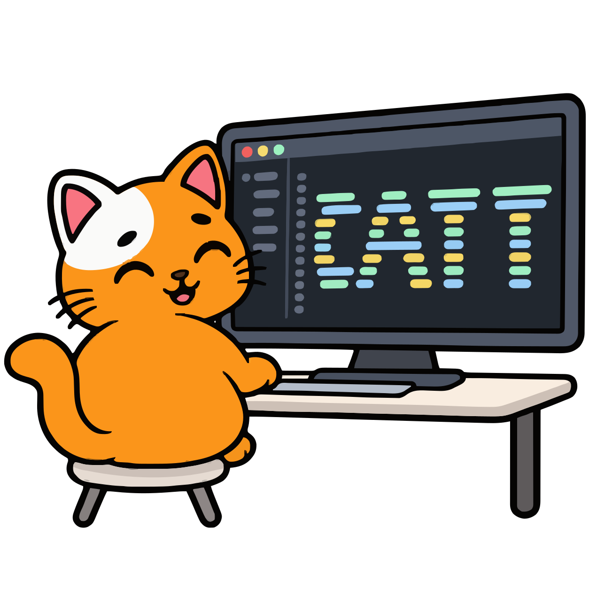

<p align="center">
  
</p>

<h1 align="center">Consumer Agent Testing Tool (CATT)</h1>

Consumer Agent Testing Tool (CATT) tests how an assistant uses your service.
Run a scripted or model-driven agent against an MCP server, an MCP app, a
website or an HTTP API. Check what the service did, inspect the evidence, and
compare results across builds.

**Muse is the initial emulation and testing target.** CATT models Meta's Muse
through a local test host. **Instinct and other assistants are planned for
later releases.** CATT does not yet emulate them. The model that drives a trial
is separate from the assistant platform being emulated.

[Contributing](CONTRIBUTING.md) | [Security](SECURITY.md) | [Changelog](CHANGELOG.md) | [MIT license](LICENSE)

> **A test host, not Muse.** CATT is a surrogate: it approximates an assistant's
> host, not its private implementation. A passing test does not certify
> compatibility with Muse or any hosted assistant. Each Muse-specific behavior
> has a recorded basis: `documented`, `unofficial`, `assumed` or `unknown`.
> This project is not affiliated with or endorsed by Meta, OpenAI or Anthropic.

## What you can test today

| Lane | Command | What it checks | Status and scope |
| --- | --- | --- | --- |
| MCP connectors | `connector-run SCENARIO` | Use the server's tools, apply account and approval rules, protect private values, and check the service's recorded outcome and the agent's answer. | Supported. Muse-like surrogate; see [connector lane](docs/connector-lane.md). |
| Connector extensions | `connector-run SCENARIO` with `extensions:` | Routes, memory, custom API clients, browser actions, wallet cards, background jobs, untrusted content, channel limits and simulated users. | Supported with the lane. `user_simulator` is exploratory and cannot run in scripted tests or decision contracts. See [extensions](docs/connector-extensions.md). |
| Scenario scaffolding | `scaffold URL --output FILE`, `scaffold --from-run RUN --output FILE` | Read a tool catalog or turn an agent run into scripted calls. Calls no service tools. Replace every `TODO(scaffold)` before running. | Supported. One Streamable HTTP connector; no OpenAPI input. |
| Muse connector readiness | `check URL --suite muse-guidelines` | Review the catalog and optional manifest against the pinned connector guidelines without calling tools. | Documented constraints, not admission. See [readiness checks](docs/readiness-checks.md). |
| Personal Agent Protocol | `check ORIGIN --suite poppy` | Read `poppy.json`. With a manifest, probe sessions, sign-in and one declared operation on the company's hosts. | Draft 0.1; no production Muse evidence. |
| Muse gadget registration | `check FILE --suite gadget` | Check a `link.register` message and command specs against the pinned SDK limits. Opens no connection. | Documented limits, not admission. The SDK's terms say it is not a developer platform. |
| MCP protocol contracts | `check TARGET` | Check schemas, version negotiation, sessions and operation contracts; run the pinned conformance suite. | Supported. Generic MCP evidence; see [readiness checks](docs/readiness-checks.md). |
| Embedded MCP apps | `surface-run SCENARIO` | Render the app in Chromium and check forms, tool calls, resources and service responses. An agent driver chooses from the scenario's scripted steps. | Supported. Generic MCP Apps host, not Muse. See [host scope](#what-the-mcp-apps-host-implements). |
| Websites | `browse POLICY`, `run --surface browser` | Act on accessibility snapshots under request rules. Takeover pauses the run (exit 3); the CLI has no handback. | Native Chromium, without OS isolation. Browser scenarios use only the packaged reservation portal. |
| HTTP APIs | `run --surface api-tools`, `inspect`, `check` | Bind approval to each proposed call and check backend outcomes. | Supported with a mapping. Your API also needs a loopback deployment and private control adapter. See [API scenarios](docs/api-scenarios.md) and [API trials](docs/api-behavior.md). |
| Evidence | `report`, `export`, `replay`, `diff` | Inspect reports, redact exports, verify playback and compare runs. | Supported. Playback and diff require sealed runs. |
| Development extensions | `--development-extensions COMMAND` | CLI binaries, isolated browsers, cloud workers, local Glimmer, generated OpenAPI and Prism mocks. | Outside the supported release. See [development extensions](#development-extensions). |

The connector lane records the basis for each Muse-specific behavior. Tool classes
and approval prompts follow documented guidelines. The `muse-cli` projection and
template client follow unofficial mirrors; the native projection is an assumed
generic baseline. These labels do not imply support for another assistant.

Three quickstarts follow. The [connector lane](#quickstart-connector-lane) and
the [popular MCP server](#quickstart-a-popular-mcp-server) quickstarts run on
loopback with no account; the [Coverage Cat sandbox](#quickstart-coverage-cat-sandbox)
quickstart calls a hosted sandbox. [Test your own service](#test-your-own-service)
turns them into a workflow, and the [documentation index](docs/README.md) lists
every page.

## Setup

You need Python 3.12 or newer (CI tests 3.12 on Linux and 3.14 on macOS),
[uv](https://docs.astral.sh/uv/), and Node.js 20 or newer with npm (the
installed packages declare `>=20`; tested with 25.9). The recorded release
evidence covers macOS. From a clone of this repository, install the Python and
Node dependencies and the Chromium build the browser lanes use:

```sh
uv sync --extra openrouter --extra dev
npm --prefix tooling ci --ignore-scripts
npm --prefix tooling/payment-ui ci --ignore-scripts
PLAYWRIGHT_BROWSERS_PATH="$PWD/.cache/ms-playwright" node tooling/payment-ui/node_modules/playwright/cli.js install chromium
```

The connector lane, the readiness checks and the scripted runs need only
`uv sync`. Node and Chromium are for the MCP Apps and browser lanes.

On Linux (Debian or Ubuntu), install Chromium with its system libraries
instead. Linux is not covered by the recorded release evidence: the commands
below match the [CI workflow](.github/workflows/ci.yml) but have not been
qualified here.

```sh
sudo apt-get update && sudo apt-get install -y nodejs npm   # or Node 20+ from nodesource or nvm
curl -LsSf https://astral.sh/uv/install.sh | sh
uv sync --extra openrouter --extra dev
npm --prefix tooling ci --ignore-scripts
npm --prefix tooling/payment-ui ci --ignore-scripts
PLAYWRIGHT_BROWSERS_PATH="$PWD/.cache/ms-playwright" \
  node tooling/payment-ui/node_modules/playwright/cli.js install --with-deps chromium
```

Three features rely on macOS Seatbelt (`sandbox-exec`) and report unsupported
or blocked on Linux rather than running unconfined: the `--offline` readiness
mode, the network-denied validator workers behind `run --surface api-tools`, and
the local-model memory profile. The connector lane, the scripted runs, the
readiness checks and the Docker-backed stdio targets do not depend on it.

Check the setup with `doctor`:

```sh
uv run consumer-agent-testing-tool doctor
```

It checks Node against the floors the installed packages declare, the
`tooling/payment-ui` packages against their pinned versions, and Chromium and
its headless shell under `.cache/ms-playwright`. It reports the optional
protocol tooling, and checks Docker only for development lanes or configured
stdio MCP and CLI targets. It makes no model requests, even when an existing
configuration or `--model-profile` selects a model. Each failed or blocked check
prints one line on stderr with its reason and, for a setup problem, the command
that fixes it.

To explicitly run the provider preflight, which sends two short model requests
and may incur charges, add `--model-preflight`:

```sh
uv run consumer-agent-testing-tool doctor --config agent.yaml --model-preflight
```

Scripted runs need no model account, and the scripted commands in all three
quickstarts need no configuration file. Agent runs need a model profile and an
API key; [Model providers](#model-providers) shows how to create one. Supply
credentials through environment variables, and keep them out of scenarios and
shared evidence. `consumer-agent-testing-tool.yaml`, the default settings file,
is local and git-ignored, and no profile is shipped.

## Quickstart: connector lane

This quickstart stays on loopback and needs no account. Complete
[Setup](#setup), then start the Cedar Stays-like test service in a second
terminal. It prints one JSON line with its URLs when it is ready; Ctrl-C stops
it:

```sh
uv run python -m consumer_agent_testing_tool.connector_fixture --port 8765 --variant good --auth none
```

Replay the example's scripted calls, with no model:

```sh
uv run consumer-agent-testing-tool connector-run examples/connector/fixture-booking.yaml \
  --driver scripted --script examples/connector/fixture-booking.calls.json
```

The script searches rooms, gets a quote, books and gives a final answer. The
host fills the guest's email from the scenario's `private:` values, which the
model never sees, and the scripted user answers each approval card from the
scenario's `permissions:` rules. After the run, the host checks the fixture's
private oracle (one confirmed booking, no duplicate charges) and the booking's
status through `get_booking`. It also checks that each sent call matched its
approval card (`approval.dispatches_match`, `approval.disclosure_bound`) and
that the final answer made no false claim and relayed the total and the
confirmation (`answer.no_false_claims`, `answer.relay_complete`).

The command prints the run directory and `Connector report: .../report.html`,
and exits 0 when every required check passed. Runs are sealed under
`runs/connector-<id>/`. Share the output of `export`, not the run directory:
its `private/` folder holds host-private values.

For an agent run, create `agent.yaml` with the `init` command in
[Model providers](#model-providers), set `OPENROUTER_API_KEY` in your shell, and run:

```sh
uv run consumer-agent-testing-tool connector-run examples/connector/fixture-booking.yaml --config agent.yaml
```

The model preflight runs first and prints its own evidence path. The agent then
sees the four allowed tools as native functions, with the host-private email
removed from their schemas, and writes the other arguments itself. This uses
paid model inference. To change the treatment without editing the scenario,
`--projection muse-cli` offers the same tools through one `exec` command,
`--exposure search-only` loads their parameters through `tool_search`,
`--output-schema strict` refuses results that break a tool's `outputSchema` as
the official MCP SDK does, and `--trials N` runs independent trials and prints
pass^k. The run lock records the projection, exposure, client-profile and
output-schema overrides under `overrides`.

`connector-run` exits 0 when every required check passed; 1 when a check
failed, the answer made a false claim or an agent limit was reached; 2 for a
setup, harness or reporting error; and 3 when the trial is blocked or
unsupported, for example by an uncertain write to reconcile, an unobservable
check or a client-profile limit. To start from your own server, run
`scaffold`; to replay a recorded, shareable agent trial without a model, turn
it into a calls file with `scaffold --from-run`. The
[connector lane](docs/connector-lane.md) reference covers scenarios, flags and
evidence. The [examples](examples/connector/README.md)
list each shipped scenario with its fixture command, and
[lane extensions](docs/connector-extensions.md) covers routes, custom
connectors, the browser sub-agent, wallets, schedules and the other
extensions.

## Quickstart: a popular MCP server

The connector lane works with any MCP server over Streamable HTTP, not only the
bundled test service. This quickstart points it at "Everything"
([`@modelcontextprotocol/server-everything`](https://github.com/modelcontextprotocol/servers/tree/main/src/everything),
MIT), the reference server the MCP project maintains for client authors. Its
weather tool returns simulated data, so it needs no account or key. Start it in
a second terminal; the first run downloads the pinned release from npm:

```sh
PORT=3001 npx -y @modelcontextprotocol/server-everything@1.0.0 streamableHttp
```

See what the host infers from the live catalog. `scaffold` runs the handshake
and `tools/list`, calls no tool, and writes a scenario skeleton with suggested
tool classes from the server's annotations:

```sh
uv run consumer-agent-testing-tool scaffold http://127.0.0.1:3001/mcp --output my-everything.yaml
uv run consumer-agent-testing-tool check http://127.0.0.1:3001/mcp --suite muse-guidelines
```

The second command reviews the catalog statically against the pinned Muse
connector guidelines. Then replay the shipped example, which asks for the
weather in Chicago, first with native tools and then through the Muse-style
command-line projection over the unofficial Muse template client:

```sh
uv run consumer-agent-testing-tool connector-run examples/connector/everything-weather.yaml \
  --driver scripted --script examples/connector/everything-weather.calls.json
uv run consumer-agent-testing-tool connector-run examples/connector/everything-weather.yaml \
  --projection muse-cli --client-profile muse-template-unofficial-2026-10 \
  --driver scripted --script examples/connector/everything-weather-cli.calls.json
```

Both exit 0. The scenario offers the model three of the server's tools; a
reviewed allowlist keeps the rest off its list, including `get-env`, which
returns the server process's environment variables, and
`gzip-file-as-resource`, which fetches any URL it is given. The server has no
private oracle, so the outcome check calls `get-structured-content` itself
after the agent stops, and the answer checks look for the temperature and
conditions the server returned. With a model profile, let an agent do the same
task three times and print pass^k (paid inference). The scenario declares no
reset URL, so `connector-run` warns that the trials share the server's state;
this weather tool keeps none:

```sh
uv run consumer-agent-testing-tool connector-run examples/connector/everything-weather.yaml \
  --config agent.yaml --trials 3
```

## Readiness checks

`check` also runs readiness suites that read catalogs and documents instead of
running an agent. With the connector-lane quickstart's fixture still running,
review its catalog and the example manifest against the pinned Muse connector
guidelines:

```sh
uv run consumer-agent-testing-tool check http://127.0.0.1:8765/mcp --suite muse-guidelines \
  --manifest examples/connector/readiness.yaml
```

| Suite | Command | Exit codes |
| --- | --- | --- |
| `muse-guidelines` | `check URL --suite muse-guidelines [--manifest FILE]` | 0 no fail finding, 1 fail findings, 2 setup error, 3 the client profile cannot reach the server |
| `muse-guidelines` drift | `check --suite muse-guidelines --drift-check` | 0 unchanged, 1 drifted, 2 not fetched |
| `poppy` | `check ORIGIN --suite poppy [--manifest FILE]` | 0 no fail finding, 1 fail findings, 2 setup error, 3 blocked |
| `gadget` | `check FILE --suite gadget` | 0 no fail finding, 1 fail findings, 2 the document cannot be read |
| `contract` (default) | `check TARGET [--interface-profile PROFILE]` | 0 every required check passed, 1 a check failed, 2 setup, harness or reporting error, 3 blocked or unsupported |

The guidelines review lists the server's tools and calls none; `--drift-check`
fetches the live guidelines, and only when given. Poppy discovery only reads.
Its probes run only with `--manifest` and act on the company's own hosts: they
start sessions, sign in the declared test account and confirm one declared
operation. The gadget suite reads one local file. The contract suite checks a
target named in the configuration file (`--config`). For a `kind: mcp` target
without declared `contract_cases`, its `operation-contracts` check is
unsupported and the run exits 3.

A clean readiness result is not an admission. Meta reviews connectors by hand,
Poppy is draft 0.1 with no production Muse evidence, and the Gadget SDK's terms
say it is not a developer platform. [Readiness checks](docs/readiness-checks.md)
describes the rules, manifests, `--offline` behavior and the
`mcp-contract-2026-07-28` profile.

## Quickstart: Coverage Cat sandbox

From a source checkout or unpacked source distribution, complete
[Setup](#setup), then run:

```sh
uv run consumer-agent-testing-tool surface-run examples/coveragecat-sandbox.yaml --driver scripted
```

The example creates a fictional shopper's draft in Coverage Cat's hosted
**sandbox** at `https://www.coveragecat.com/api/consumer/mcp`. It needs no
Coverage Cat account, operator credentials or model API key.

The first `umbrella_consumer_prefill` call sets `sandbox: true`, as specified in
the [consumer MCP manifest](https://www.coveragecat.com/.well-known/mcp.json).
That argument activates the server's sandbox. The scenario's `test_only: true`
flag merely records the test author's intent.

The host fixes the tool arguments and keeps the returned access token private.
It permits two tools, `umbrella_consumer_prefill` and `consumer_intake_issues`,
and checks that:

1. Prefill returns `sandbox: true`.
2. Follow-up retains `sandbox: true`.
3. Follow-up returns the original application ID.
4. The server reports `application_submitted: false`.

Each run creates a new draft and stops before submission. A failed or missing
sandbox check stops the workflow. These checks cover draft creation and
follow-up, not payment widgets, browser behavior or independent backend checks.

To let a model choose the steps, create `agent.yaml` with the `init` command in
[Model providers](#model-providers), set `OPENROUTER_API_KEY` in your shell, and run:

```sh
uv run consumer-agent-testing-tool surface-run examples/coveragecat-sandbox.yaml \
  --driver agent --config agent.yaml
```

The agent driver is a **scripted action menu**: Spark Open picks one ready
scenario step per turn, and the host runs it with the scenario's arguments. The
model never sees the server's tools, schemas or raw results, only the result
fields the scenario exposes, and the evidence is labeled `scripted action menu`.
The host supplies the test inputs and checks the results. This version uses
paid model inference through Together, with ZDR enabled and fallback disabled
by default.

**Verified 15 October 2026:** both scripted and Spark Open agent runs passed all
four sandbox checks. Both model responses identified Together; both requests
used the configured ZDR policy. See the
[recorded quickstart results](docs/release-evidence/coveragecat-sandbox-quickstart-2026-10-15.json).

Each command prints an outcome line, such as `Surface run completed (exit 0)`,
then `Surface report: .../report.html`. Open the report to inspect the workflow
and its checks. The same directory contains `result.json` for the structured
result and `events.jsonl` for the redacted event timeline. Agent runs also store
model and tool records under `agent/`.

Replace the placeholders below with the run directories printed by your commands:

```sh
uv run consumer-agent-testing-tool report runs/surface-YOUR_RUN_ID
uv run consumer-agent-testing-tool export runs/surface-YOUR_RUN_ID
uv run consumer-agent-testing-tool diff runs/surface-BASELINE_ID runs/surface-CANDIDATE_ID
```

Share the generated export. Keep the full run folder private. While a run can
resume, `checkpoint.private.json` holds the credentials, tool results and host
inputs it needs; a completed run, or one that failed with exit 1 and left no
write unconfirmed, keeps only a scrubbed record.

To test your own MCP service, copy the example and replace its endpoint, allowed
origins, tool policies, test data and response checks.
[Surface workflows](docs/surface-workflows.md) explains UI steps, the agent
driver and resuming runs.

### Extend through submission and sandbox checkout

The [checkout example](examples/coveragecat-sandbox-checkout.yaml) adds review,
submission, Monoline offer selection, consent, bind follow-up, document upload
and simulated payment-method setup. Its 14 steps contain 62 assertions. All
seven tools use the consumer umbrella MCP, and every service step must return
the same sandbox intake.

**Current integration status, 15 October 2026: blocked at submission.**
Coverage Cat returns quote fields that its MCP output schema excludes. It also
returns `minimum_auto_limits` as a string where the schema requires an object.
The host rejects the response. The draft quickstart passes, but the full checkout
test has **not passed end to end**. See the
[failure report and separate diagnostics](docs/coveragecat-sandbox-checkout.md).

Run this command to reproduce the failure or retest after the service contract
is corrected:

```sh
uv run consumer-agent-testing-tool surface-run examples/coveragecat-sandbox-checkout.yaml \
  --driver scripted \
  --replies examples/coveragecat-sandbox-checkout-replies.json
```

The reply files supply a **fictional shopper's answers**: approval to submit,
credit consent, the Monoline $2M offer at $389, sufficient auto limits, declined
excess UM/UIM, and “No” to both carrier questions. These fixtures do not authorize
transactions for a real shopper. A changed quote or missing or negative approval
stops the next write. The two generated declarations PDFs are labelled
`SYNTHETIC TEST ONLY`.

Once submission works, the example pauses with exit code 3 at
`sandbox_document_review_poll`. **Only at that checkpoint**, wait at least the
reported 60 seconds and resume the printed run:

```sh
sleep 60
uv run consumer-agent-testing-tool surface-run examples/coveragecat-sandbox-checkout.yaml \
  --driver scripted --resume runs/surface-YOUR_RUN_ID \
  --replies examples/coveragecat-sandbox-checkout-after-review.json
```

The host pauses for your reply but does not measure how long you wait. The
after-review fixture approves the simulated payment callback.

For an agent-driven run, replace `--driver scripted` with
`--driver agent --config agent.yaml` on **both** commands. A resumed run must
keep its original scenario, driver and model configuration.

The sandbox supplies mock payment credentials. The example sends the returned
`seti_sandbox_...` with the fixture `pm_sandbox_consumer_agent_testing_tool`, then requires
`payment_method_on_file`, `waiting_on_carrier`, and no charge confirmation.
Billing checks inspect setup metadata rather than rendered fields. No Stripe
form opens, no card details are collected, and no fallback URL is used. This
test establishes neither premium collection nor active insurance. Test the
embedded payment UI and Stripe test-mode setup separately.

## Test your own service

The quickstarts above are the pieces of one workflow. For an MCP server you
own:

1. **Write a scenario.** `scaffold URL --output my-connector.yaml` reads the
   live catalog (`--auth-env VAR` for an API key, or `--auth-from FILE` with a
   scenario that holds an OAuth block) and writes a skeleton. Replace every
   `TODO(scaffold)`: the user's goal in their own words, the allowlist of tools a
   reviewed connector would expose, tool classes your documentation settles,
   approval rules for the scripted user, host-private values such as the
   user's email, and checks that read the real outcome, from a private state URL
   (an oracle) or one of your read tools.
2. **Check readiness.** `check URL --suite muse-guidelines --manifest FILE`
   reviews the catalog and your declarations against the pinned connector
   guidelines. A clean result is a documented constraint, not an admission.
3. **Pin the happy path.** Replay a scripted calls file with `--driver
   scripted`; it needs no model and belongs in CI. After an agent trial you
   trust, `scaffold --from-run RUN --output FILE` turns it into one.
4. **Run agent trials.** `--trials N` with a model profile gives pass^k. Run
   the same scenario under each treatment a Muse-like host may use:
   `--projection muse-cli`, `--exposure search-only`,
   `--client-profile muse-template-unofficial-2026-10` and
   `--output-schema strict`. The run lock records each one.
5. **Add realism.** [Lane extensions](docs/connector-extensions.md) add
   competing connectors and connect-on-request, payment with single-use cards,
   background jobs, untrusted content, channel limits and a simulated user.
6. **Compare builds.** `diff` compares two sealed runs and exits 1 on an
   outcome regression. Share the output of `export`; the run directory's
   `private/` folder holds host-private values.

For an MCP app with its own UI, start from the Coverage Cat scenario and
`surface-run`. For a website, use `browse` with a browser policy, or the
connector lane's `browser` extension. For an HTTP API, write a mapping for
`run --surface api-tools`, or test whether an agent can build its own client
from your docs with the `custom_connector` extension.
[Run a consumer test](#run-a-consumer-test) covers the other lanes.

## Model providers

Create a profile with `init`. This one uses **Muse Spark Open**
(`meta/muse-spark-open`) through OpenRouter, routed only to Together, with zero
data retention (ZDR) required and fallback disabled; set `OPENROUTER_API_KEY` in
your shell before an agent run:

```sh
uv run consumer-agent-testing-tool init --provider openrouter --model meta/muse-spark-open \
  --routing-provider together --config agent.yaml
```

`init` also stages, beside the configuration, the API scenarios, the browser
scenarios and the mapped-API example. It stages only scenarios the supported
CLI can run, and refuses providers that have only a configuration template
(`openai`, `anthropic`, `gemini`, `azure-openai`, `vertex-gemini`,
`openai-compatible`) unless `--development-extensions` comes before `init`.
`init --provider none --config scripted.yaml` writes a configuration for
scripted commands that need one. `init` refuses to overwrite an existing file.

Profiles that `init` writes are labeled `specified/unverified`. `doctor --model-preflight`, `run`
and the agent drivers of `connector-run`, `surface-run` and `browse` print a
warning for any profile not labeled `supported`, and the run lock records the
label. Model IDs that contain `contributor` select a mode in which the provider
may train on your prompts; such a profile needs
`allow_training_on_prompts: true` (`init --allow-training-on-prompts`). See
[model providers](docs/model-providers.md) for every adapter, its checks and
its failure labels.

### OpenRouter model and privacy settings

Consumer Agent Testing Tool requests **zero data retention (ZDR) by default**, even when
`routing.zdr` is omitted. To change this, edit the selected profile in
`consumer-agent-testing-tool.yaml` or the file passed to `--config`:

```yaml
model_profiles:
  openrouter-dev:
    provider: openrouter
    api: chat-completions
    model_id: meta/muse-spark-open
    auth:
      mode: api_key
      env: OPENROUTER_API_KEY
    routing:
      only: [together]
      allow_fallbacks: false
      require_parameters: true
      data_collection: deny
      zdr: true  # Set to false to disable this tool's per-request ZDR requirement.
defaults:
  model_profile: openrouter-dev
```

Use unquoted YAML booleans: `true` or `false`. Consumer Agent Testing Tool applies the setting to
every OpenRouter request, including requests that continue after a tool result,
and records it in the routing evidence.

Setting `zdr: false` removes this request-level requirement. It leaves
`data_collection: deny`, the pinned provider and the ban on fallbacks in place.
Your OpenRouter account or guardrails may still enforce ZDR. Request logs show
the policy sent; they cannot independently verify the provider's retention
practices. See [OpenRouter's ZDR documentation](https://openrouter.ai/docs/guides/features/zdr).

**Checked 15 October 2026:** OpenRouter listed Together for Spark Open in both
its model and ZDR endpoint catalogs. A live tool-call test passed with the
routing settings above. Both responses identified Together, and the model used
the tool result correctly. See the
[test record](docs/release-evidence/together-spark-zdr-live-2026-10-15.json).

To choose another provider, set `routing.only` or pass `--routing-provider` to
`init`. Requests never switch
providers or models silently.

Runs use Inspect's dedicated `openrouter` provider, which replays earlier
reasoning in structured form rather than as text. Each response must name the
pinned provider. Responses do not name endpoint variants, so a pin such as
`nebius/fp4` is recorded as `variant unverified`. Streaming is not supported.
See [model providers](docs/model-providers.md#openrouter).

With `zdr: true`, only ZDR-listed endpoints are eligible. On 15 October 2026,
Muse Spark 1.3 and Muse Wonder were served only by Meta on OpenRouter and were
not ZDR-listed, so no ZDR-compliant OpenRouter route existed for them. A
request for them is expected to fail, but no live run has recorded the error.
When OpenRouter's error cites the data policy, it is labeled
`no endpoint satisfies the routing/ZDR policy`. With `routing.only: [together]`,
the `init` default, it may instead be labeled
`routing policy: no allowed provider`.

Sources: [Meta announcement](https://research.meta.ai/blog/muse-spark-open),
[OpenRouter model](https://openrouter.ai/meta/muse-spark-open),
[provider endpoints](https://openrouter.ai/api/v1/models/meta/muse-spark-open/endpoints),
and [ZDR endpoints](https://openrouter.ai/api/v1/endpoints/zdr).

The standalone smoke test and older consumer helper read the same `--config`
and `--model-profile`, including privacy settings. Profiles that `init` writes
leave reasoning effort unset.

```sh
.venv/bin/python scripts/openrouter_smoke.py --config agent.yaml \
  --model-profile openrouter-dev
```

This command tests the model connection with synthetic tool data. It needs an
API key and an available route to the pinned provider. It makes no requests to
the service you plan to test.

### Meta Model API

`init --provider meta` writes a profile for Meta's Model API:

```sh
uv run consumer-agent-testing-tool init --provider meta --model muse-spark-1.3 --config meta.yaml
```

The profile uses the Responses API at `https://api.meta.ai/v1` and reads the key
from `MODEL_API_KEY` or `META_API_KEY`; if both are set, they must agree. Add
`--api chat-completions` for Chat Completions, or `--key-env NAME` to use another
variable, which is then the only one read. The adapter uses the OpenAI SDK from
the `openrouter` extra.

The host refuses requests that Meta rejects, such as a forced tool choice,
before sending them (exit 3). Meta adds steering context to every prompt on its
servers, so captured requests are incomplete, and every Meta run records this
as an observation gap. Streaming is not supported, and the API is
pay-as-you-go. See [Meta Model API](docs/model-providers.md#meta-model-api).
No live Meta Model API run has been recorded; the adapter is tested against
local fixtures.

## Run a consumer test

This section covers the embedded MCP apps (`surface-run`), browser (`browse`)
and HTTP API lanes. To let an agent use your MCP server's own tools, use the
[connector lane](#quickstart-connector-lane).

A scenario defines the endpoint, allowed origins, tools, private arguments, UI
actions, consent requirements and result checks, and optionally an API key
for the MCP connection (`auth`). Use endpoints and synthetic transactions you
have permission to test.

```sh
consumer-agent-testing-tool surface-run path/to/scenario.yaml --driver scripted
consumer-agent-testing-tool surface-run path/to/scenario.yaml --driver agent --config agent.yaml
consumer-agent-testing-tool surface-run path/to/scenario.yaml --resume runs/existing-run
consumer-agent-testing-tool browse path/to/browser-policy.json --actions path/to/actions.json
```

The host declares MCP Apps support as a client, finds each tool's UI through its
`tools/list` definition and renders it in a native browser. With
`--driver agent`, the model picks among the scenario's steps (a scripted action
menu) and never sees the server's tools, raw results or private inputs. Service
checks determine the result; a rendered form or a model's claim of success
cannot prove that a transaction completed.

`browse` drives a restricted browser through accessibility snapshots and element
references, with no selectors, scripts or CDP. Its policy file sets the start
`url`, the permitted `origins` and request `rules`, `snapshot_max_chars`
(default 20,000), `history_snapshots` (2) and `dialogs` (`agent`, `accept` or
`dismiss`), as in [examples/browser-policy.json](examples/browser-policy.json).
Long snapshots are paged with `{"kind": "snapshot", "offset": N}`. Refused or
failed actions come back to the agent as observations with a `status`, and
dialogs and file choosers are answered with `kind: dialog` or `kind: upload`.
With `--driver agent`, the provider preflight runs before the browser opens.
The result's `observations` block counts truncated snapshots and refused
actions. When the agent requests a takeover, the run pauses (exit 3). The CLI
has no handback, so control does not return to the agent in that run. In
native mode, WebSockets opened by dedicated workers and WebRTC TCP relays are
not enforced. The policy field `webmcp: true`, off by default, lists
page-registered WebMCP tools in the snapshot and lets the agent call them with
`kind: webmcp`; that lane is labeled "generic WebMCP page tools, not Muse"
(basis: `assumed`), and its evidence notes that Meta documents WebMCP for its
AI glasses, a Meta product that is not Muse. See
[restricted browser behavior](docs/release-extensions.md#restricted-browser-behavior).

HTTP API tests use explicit mappings with the scenario runner. Mappings can
send declared request headers and put the target credential in a custom API-key
header. In API and browser trials, invalid tool proposals are returned to the
model as tool errors, and exhausted limits fail the trial; see
[API scenarios](docs/api-scenarios.md#agent-mistakes-and-limits). To test
whether an agent can build its own client from an API's documentation instead,
use the connector lane's `custom_connector` extension. Prism, Schemathesis and
generated-OpenAPI tools are available only as development extensions. Their
five packages with unresolved original license notices are excluded from the
supported release, not treated as cleared.

### Outcomes and exit codes

`surface-run` follows the exit codes in spec §18:

| Exit | Meaning |
| --- | --- |
| 0 | Completed |
| 1 | Failed: an assertion, a service rejection, a UI interaction failure or an agent error |
| 2 | Setup, infrastructure, integration or reporting failure |
| 3 | Blocked or unsupported: waiting for a reply or approval, an unconfirmed write, a limit, or missing coverage |

Before `Surface report: ...` it prints one line:
`Surface run <status> (exit N) at <stage> [<class>]: <reason>`. `result.json`
records the same `failure_class` and `failure_stage`, and whether the run is
`resumable`. A completed run, or one that failed with exit 1, is final unless
the failure left a write unconfirmed: that write may have taken effect, so the
run stays resumable to reconcile it. Blocked runs and setup failures can resume.

`run` and `browse` use the same four codes, except that exhausting a turn,
tool-call or time limit is a failure (exit 1). Only Inspect operator and custom
limits, and in `run` a deadline that passed before an attempt's first
generation, block instead (exit 3). `run` prints each evidence path on stdout.
`browse` prints the final observation and its evidence path when the run
completes or pauses for takeover, and nothing on stdout otherwise. For any
outcome other than completed, both also print one line on stderr:
`<label> <status> (<class>) at <check>: <reason>. Evidence: <path>`. The label
names the step, for example `Model preflight`, `Trial 2/10 of stale_total`,
`Resumed trial of stale_total` or `Browse` (`doctor` uses `Doctor check`). A
`run` with a failed or blocked trial, or with `--trials` above 1, also prints a
summary line with the counts. With `--trials` above 1 it adds the suite
pass^k, the mean over scenarios, for example
`Run completed: 0 failed, 0 blocked and 4 completed of 4 trials; pass^1 1.00, pass^2 1.00. Evidence: ...`.
The suite's metrics also break the trials down by scenario
([statistical decisions](docs/statistical-invariants.md)). `run DIR` refuses
(exit 2), before the preflight, a directory whose scenario files share an id.

`connector-run` prints the same stderr line, labeled for example
`Connector trial 1/1 of fixture-booking-happy-path`; its codes are listed in the
[connector-lane quickstart](#quickstart-connector-lane). With `--trials N`, one
code stands for all trials: 2 when any trial's evidence is not shareable, else 1
when any trial failed, else 2 when any hit a setup, harness or verification
error, else 3 when any was blocked, else 0. The `Connector trials:` line on
stderr gives pass^k and names the trials that are not shareable or ended in an
error. The readiness suites' codes are in [Readiness checks](#readiness-checks).

### What the MCP Apps host implements

The embedded-app lane is generic MCP Apps host evidence (MCP Apps 2026-01-26),
for hosts such as ChatGPT or Claude. It is not Muse evidence: Muse documents no
third-party UI. Each `result.json` says so under `mcp_apps_host`.

The host implements:

- the client capability (`io.modelcontextprotocol/ui` with
  `text/html;profile=mcp-app`), UI discovery from the tool's `tools/list`
  definition, and HTML resources as text or base64 blobs;
- `tool-input` with the call's arguments, `tool-result`, and a `hostContext`
  (theme, display mode, locale, time zone, platform, container width and
  maximum height, and tool information);
- a content security policy built from the resource's `_meta.ui.csp`, or the
  specification's restrictive default when the resource declares none, and the
  declared camera, microphone, geolocation and clipboard-write permissions;
- in the native renderer, a sandbox proxy on an origin separate from the host
  page. With `browser_origins`, the host page also has Chromium's
  local-network-access permission, every redirect hop is checked again (GET
  or HEAD to an allowlisted origin only), and each direct write is recorded as
  an unconsented `host_action` before it is sent;
- view `tools/call` requests for the step's allowlisted tools, and
  `resources/read` and `resources/list` for the step's `callback_resources`;
- `ui/message`, delivered once to agent runs in the next observation a model
  reads, as `app_messages`; the view is told when the host does not deliver
  it. `ui/update-model-context`, `ui/open-link`, display-mode, log and
  teardown requests are recorded, and the latest model-context update reaches
  agent runs as `app_context`;
- size changes, `ui/resource-teardown` before the view closes, and
  `tool-cancelled` when the view never received the call's result;
- `_meta.ui.visibility`, for view calls and for tool steps;
- MCP 2026-07-28 servers, when the scenario sets `version_negotiation: auto`.
  The default is the 2025 `initialize` handshake;
- an API key on the MCP connection (`auth`), as a bearer token, a custom
  header or a query parameter;
- a legacy `window.openai` bridge.

It does not implement a model turn for a view's message, resource templates,
`_meta.ui.domain`, display modes other than inline, partial tool input,
host-context change notifications, OAuth on the MCP connection, or consent for
a view's direct writes in the native renderer. The legacy bridge and the
isolated renderer have no sandbox proxy. See
[MCP Apps host](docs/surface-workflows.md#mcp-apps-host).

## Inspect retained evidence

```sh
consumer-agent-testing-tool report runs/existing-run
consumer-agent-testing-tool export runs/existing-run
consumer-agent-testing-tool replay runs/existing-run
consumer-agent-testing-tool diff runs/baseline runs/candidate
```

Replay checks the evidence seals and stops on a mismatch. It never substitutes
a live request. To test the service again, start a new run. Reports mark missing
measurements as unknown and keep partial totals distinct from complete totals.

Reports open with the verdict, which names the failing step and check, then
the checks and host capabilities, and a per-step timeline that shows what the
model received in full. Then come a connectors table for runs with several
connectors, the surface views (what the service published, what the model was
offered, what it received at each step, and what only the developer sees),
the metrics, and the viewers and linked evidence: agent and preflight runs,
their Inspect logs and the `inspect view` command, and, locally, a captured
Playwright trace. Gaps and limits follow, then the run lock and the full
recorded result, each collapsed; see
[report layout](docs/report-recovery.md#report-layout). `report` on an agent
sub-run of a sealed run returns its sealed report unchanged.

Evidence files and exports hide credentials, registered secrets, contact
details and other personal fields such as names and addresses. Model views keep
the user's own data visible: they hide only credentials and declared secrets,
plus browser password fields and, in a resumed browser scenario, text typed in
an earlier attempt. The provider boundary refuses any model request that still
contains a registered credential. Export also applies the run's own private
values, which are never exported, and refuses (exit 2) when a staged file, or
a member of an Inspect log or other archive, still holds one. See
[redaction](docs/sealed-event-provenance.md#redaction).

`diff` compares two sealed runs, such as surface, browser or connector runs. A
change to the package source counts as a run-lock change, so compare runs made
from the same checkout. It exits 0 when they are
comparable with no outcome regression, and 1 when an outcome regressed: a worse
status, or a passing check that no longer passes or is missing. It exits 3 when
they are not comparable, because of a run-lock change outside `--treatment` or
an unsealed or unverifiable run. Generated IDs and service timestamps are
normalized; run locks are compared exactly. `--ignore POINTER` (repeatable)
excludes a JSON pointer under `/outcomes`, `/capabilities` or `/milestones`,
and `--treatment /server` declares an intentional server build change. See
[replay and diff](docs/release-extensions.md#replay-and-diff).

For more detail, see the [documentation index](docs/README.md),
[connector lane](docs/connector-lane.md),
[lane extensions](docs/connector-extensions.md),
[readiness checks](docs/readiness-checks.md),
[consumer tests](docs/consumer-test.md),
[browser diagnostics](docs/browser-diagnostics.md),
[measurement coverage](docs/measurement-coverage.md),
[model timing](docs/model-timing.md), and
[release extensions](docs/release-extensions.md), which includes development history.

## Use it in CI

Scripted connector runs need no model and no key, and they replay the same calls every time, so they
work as a pull-request check. `connector-run` can start the service itself and write reports a CI
system reads:

```sh
uv run consumer-agent-testing-tool connector-run my-connector.yaml \
  --driver scripted --script my-connector.calls.json \
  --start "python -m my_service --port {port}" \
  --junit reports/connector.xml --summary-json reports/connector.json
```

- `--start COMMAND` runs the service on a free loopback port. The command is split like a shell
  command but not run in a shell.
  - `{port}` in the command is that port. The service also gets it as `PORT` and the scenario as
    `${PORT}`.
  - The tool waits until `--ready-url`, or the scenario's first connector endpoint, answers HTTP. It
    waits at most `--ready-timeout` seconds (default 30).
  - When the run ends, the service's process group gets SIGTERM, then SIGKILL after 5 seconds.
  - Its output goes to `runs/service-<id>.log`, outside the sealed run. That log isn't redacted, so
    pass secrets to the service through the environment. The run lock records the command with
    credentials redacted.
  - A service that exits early or never becomes ready exits 2.
- `--junit FILE` writes one test suite per trial and one test case per check. Blocked checks are
  `<skipped>`. `check --suite muse-guidelines` accepts it too.
- `--summary-json FILE` writes the verdict, exit code, checks, trials, pass^k and run paths. Its format
  is [`schemas/summary-v1.schema.json`](schemas/summary-v1.schema.json). `--summary-json -` prints only
  that JSON on stdout and moves the other lines to stderr.
- Both reports are also written when the command stops with an error. See
  [CI outputs and services](docs/connector-lane.md#ci-outputs-and-services).

The exit codes in [Outcomes and exit codes](#outcomes-and-exit-codes) decide the step. A 3 (blocked
or unsupported) is not a pass.
[`examples/ci/connector-lane.yml`](examples/ci/connector-lane.yml) is a GitHub Actions template with
two jobs. On pull requests, it runs the scripted calls and the readiness review. Nightly or on demand,
it runs agent trials under each Muse-like treatment, and only when a model key secret is set.
[`.github/workflows/ci.yml`](.github/workflows/ci.yml) runs this repository's tests and shipped
examples on macOS and Linux. Coding agents should start with [`AGENTS.md`](AGENTS.md).
All matrix jobs feed the required `CI` check; Linux failures are not allowed to pass silently.
Workflow validation, tracked-file hygiene, secret scanning and schema freshness are checked too.

## Running the tests

Plain `pytest` runs the supported collection:

```sh
uv run pytest -q
```

`tests/conftest.py` gives each session a temporary directory, home and cache
under `.cache/pytest/`, removes them after a passing session, and removes the
surface and browser run directories its tests create under `runs/`. The full collection takes about
twenty minutes and makes no network request beyond loopback and no model
request. `pytest --development-extensions` also collects the experimental
tests, which may need other runtimes, tools and external evidence.
Async cleanup and unhandled thread exceptions fail tests instead of remaining warnings.
See [CONTRIBUTING.md](CONTRIBUTING.md) for the review workflow and
[the launch checklist](docs/open-source-launch.md) for the private-to-public transition.

## Release audit

The supported release is **`local-consumer-v1`**: the connector lane and its
extensions, the readiness checks, consumer MCP apps, the restricted browser,
mapped HTTP APIs, transactional consent, continuation, evidence and replay,
measurements, the distribution, and the OpenRouter and Meta Model API
adapters. Real-Muse calibration, cloud provisioning, local Glimmer, browser OS
isolation and live Bedrock qualification are outside it; see
[release scope](docs/release-scope.md) for the full boundary.

Release evidence is generated per release and is not committed.
[`docs/release-gates.json`](docs/release-gates.json) is the committed policy:
the gates, the scope and the exclusions. The
[release workflow](.github/workflows/release.yml) runs on a `v*` tag. It records
every gate on macOS, requires the audit to pass, and attaches three things to
the GitHub release:

- the wheel and the source archive, with signed build provenance;
- `release-evidence-<commit>.tar.gz`, which holds `release/release-gates.json`
  (the recorded ledger) and `release/evidence/`.

Use `consumer-agent-testing-tool release-audit` to check release readiness. It
reads `release/release-gates.json` when evidence has been recorded or extracted
there. Without it, it reads the committed policy and reports every gate
unverified. Exit code 0 means **release-ready for `local-consumer-v1`**; exit
code 3 means at least one required gate needs attention. The evidence binds a
digest of the source, so a source change or an expired gate (seven days after
recording) cannot inherit an earlier passing result. To audit a published
release, check out its tag, extract its evidence archive at the repository root
and run the audit before the gates expire.

Day to day, you don't need any of this. Run the tests for what you change, and
let [CI](.github/workflows/ci.yml) run the full collection on each pull
request.

A separate live Spark Open test passed through Together with ZDR enabled. It
verified native tool calls, continuation after a tool result, and the requested
routing policy. It did not test streaming, independently verify retention
practices, or establish compatibility with every consumer workflow. The Coverage
Cat checkout failure described above remains an open integration issue.

The audit requires four gates:

| Gate | Evidence required |
| --- | --- |
| Regression | Every test in the default supported collection passes, with no skips |
| Distribution | Fresh offline installation, original dependency notices, artifact integrity and packaged consumer workflows |
| Transactional consent | Passing consent, continuation and effect checks in the current regression |
| Replay/diff | Passing evidence-integrity and comparison checks in the current regression |

To record evidence locally instead, for example before tagging, run the same
steps as the workflow, in this order. `verify_distribution.py` regenerates the
dependency notices, which are part of the source fingerprint, so the
distribution comes before the regression. The regression takes about twenty
minutes. Everything is written under `release/`, which git ignores:

```sh
.venv/bin/python scripts/verify_distribution.py
.venv/bin/python scripts/record_distribution.py
.venv/bin/python scripts/run_regression.py release/evidence/regression-run.xml
.venv/bin/python scripts/record_regression.py release/evidence/regression-run.xml
.venv/bin/python scripts/record_release_tests.py release/evidence/regression-run.xml
consumer-agent-testing-tool release-audit
```

`run_regression.py` refuses an existing report path, so remove `release/` or
pick a new name to record again. It records workspace-relative paths and writes
the home directory as `~` in the log.

Distribution checks use caches in the workspace and the installed browser.
They need no Docker VM, cloud worker or model credentials. If a dependency cache
is missing, populate it separately with
`scripts/verify_distribution.py --prepare-cache`; that setup step uses the network.
The installation evidence covers macOS only.

The audit verifies source fingerprints, artifact hashes, required checks and
expiry dates. It returns 0 when every required gate passes, or 3 otherwise.
Excluded capabilities remain labelled as excluded.
[Qualification inputs](docs/qualification-inputs.md) explains what each gate needs.

## Development extensions

The repository retains worker, isolation, local-model, calibration and
generated-OpenAPI experiments, and the CLI/skill lane for a developer's own CLI
binary (`run --surface cli-skill`), which needs Docker and an oracle that
returns the reservation fixture's snapshot schema. The normal CLI rejects these
paths. To use them, put `--development-extensions` before the subcommand and
install the separate `development-extensions` dependency group and any required
tooling. These experiments are outside the supported release. The supported way
to give an agent a CLI over an MCP server is
`connector-run --projection muse-cli`.

The optional Node API tools have [known dependency advisories](docs/dependency-security.md).
Do not use them with untrusted inputs while those findings remain open.

The [original specification](docs/spec-v0.3.md) and earlier test records document
the project's history; they do not define the scope of this release.

## License

MIT; see [LICENSE](LICENSE). The license does not cover the Coverage Cat and CATT names or
the logo; see [TRADEMARKS.md](TRADEMARKS.md). Third-party components keep their own
licenses; the distribution ships their notices under `third_party/`.
