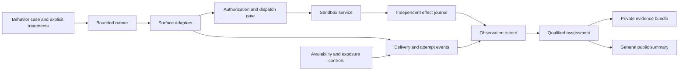

# Architecture recommendations from sandbox behavior testing

Status: **implemented as opt-in local capabilities**, 30 October 2026.
The design below records the rationale and acceptance boundaries. The
[runtime guide](behavior-runtime.md) describes the implemented interfaces and
their limits. Existing surrogate defaults, source labels and release
qualification remain unchanged. Version 3 observation artifacts supplement the
historical readers.

The sandbox exercises showed why the harness must keep actions, observations,
delivery and interpretation separate. They also exposed limitations in
fixtures and coordination. Public descriptions deliberately omit participant
identity, exact prompts and private provider records. The recommendations apply
to any supported surrogate or separately authorized external participant.

## Structure

Reuse the existing connector runner, permission engine, extension interface and
sealed evidence. Add narrow components around them; do not grow one study's
coordinator into a second general-purpose runner.

The journal reports what the service did. Adapter events report what was sent,
received or attempted. Neither implies hidden model state. The assessment
requires the relevant observation and exposure evidence before giving a verdict.

| ID | Priority | Recommendation |
| --- | --- | --- |
| ARCH-01 | P0 | Version a subject-neutral observation and calibration contract |
| ARCH-02 | P0 | Correlate proposed actions, dispatches, effects and reconciliation |
| ARCH-03 | P0 | Model delivery and revocation as explicit events |
| ARCH-04 | P1 | Make browser/session lifetime an opt-in treatment |
| ARCH-05 | P1 | Separate scheduling semantics from hosting validity |
| ARCH-06 | P1 | Separate credential use, disclosure and internal visibility |
| ARCH-07 | P1 | Require exposure and positive controls for decisive claims |
| ARCH-08 | P1 | Bind outcome claims to tasks, objects and time |
| ARCH-09 | P2 | Extract a bounded sandbox runner and controlled publication path |

## Implementation map

| Proposal | Implementation and verification |
| --- | --- |
| ARCH-01 | `behavior_observations.py`, shared calibration reader/analyzer, v3 pair/cohort schemas; `test_behavior_observations.py` |
| ARCH-02 | `behavior_journal.py`, opt-in `ext_behavior.py`, connector and browser dispatch hooks, single-recovery adapter API; `test_behavior_journal.py`, `test_behavior_integration.py` |
| ARCH-03 | Journal delivery stages and revisioned grants, synchronous final dispatch guard; delivery and revocation regressions in those same tests |
| ARCH-04 | `behavior_sessions.py`, browser conversation leases and private host storage capability; `test_behavior_browser.py`, `test_behavior_treatments.py` |
| ARCH-05 | `behavior_clock.py`, explicit fixture-clock labels, bounded HTTP observer and durable schedule records; scheduling and outage regressions |
| ARCH-06 | `behavior_credentials.py`, content-trust stage events, generated synthetic disclosure fixture; credential and existing private-fill regressions |
| ARCH-07 | Case prerequisites, isolated control receipts and coherent-fixture validation in `behavior_observations.py`; exposure/control regressions |
| ARCH-08 | Optional literal-span annotations and task/action/object/time references in `answer.py` and connector scenarios; context and held-out claim regressions |
| ARCH-09 | `behavior_sandbox.py` and `tools/behavior-sandbox/`, single writer, bounded scripted adapter and allowlisted public summary; restart/publication regressions |

These are local harness interfaces. The convenience batch adapter leaves
behavior verdicts inconclusive until exposure/control evidence is supplied.
The connector lane still blocks uncertain writes by default; optional recovery
is an adapter API. Session leases retain state in memory within one conversation;
encrypted checkpoints are not implemented. The existing scheduler keeps its
virtual-clock behavior; durable schedule records are a separate adapter
component. No provider-specific contact adapter or external campaign is enabled.

## ARCH-01 — Observation and calibration contract

**Current base:** [calibration observations](../src/consumer_agent_testing_tool/calibration_observations.py)
already bind annotations to hashed artifacts and reject unsupported outcome
annotations. [Calibration](../src/consumer_agent_testing_tool/calibration.py)
still has assistant-specific side names and evidence kinds.

**Proposal:** introduce a new version with `local` and `observed` sides,
explicit subject/profile identity in private evidence, and independent fields
for completion, measurement validity and rule verdict. Keep the current reader
for existing artifacts; migrate into a new artifact instead of rewriting seals.

Record at least:

- Case, fixture, profile and surface revisions; account/session cohort and
  prior-context treatment.
- Artifact references with source type, content digest and timestamp precision.
- Disposition: observed, blocked or forgone.
- Exposure: reached, not reached or unknown.
- Infrastructure validity: observed healthy, interrupted or unknown.
- Rule verdict: supported, contradicted or inconclusive, with its evidence.

Keep existing per-dimension completeness. An operation can be observed while
its surrounding request trace remains partial. Do not collapse these fields
into a single `success` boolean or count excluded cases in a pass rate.
An unavailable internal property remains unknown, even when task output is
correct.

**Acceptance:** old pairs still verify; a new participant type requires no
copy of the analyzer; unexposed conditions and infrastructure gaps cannot become
passes; surface-mismatched controls are labeled as controls and excluded from
matched-agreement statistics. Profile identity must survive private replay even
when omitted from a public summary.

## ARCH-02 — Action and effect journal

**Current base:** `ToolsSpec.reconcile` in
[connector scenarios](../src/consumer_agent_testing_tool/connector_scenario.py)
declares independent reads.
[The runner](../src/consumer_agent_testing_tool/connector_run.py) already
reconciles uncertain writes without sending another write. The
[route extension](../src/consumer_agent_testing_tool/ext_routes.py) accounts
for commitments across several surfaces.

**Proposal:** give each intended action a stable, explicitly scoped ID and
record separate proposal, authorized-dispatch, transport-response and
service-effect events. Bind the ID to principal, service, action and the
relevant disclosed terms. A backend transaction ID is evidence of an effect;
an HTTP result is evidence about delivery.

Use that journal across browser, connector and controlled-contact adapters.
Record the reconciliation read and whether it established commitment,
non-commitment or continuing uncertainty. Keep the default block on uncertain
writes. An optional recovery treatment may retry only after a declared read
establishes non-commitment and the original authority still applies.

Transport deduplication and user intent are different. Repeating one delivered
message can share an idempotency key; two separately authorized reservations
must not be merged merely because their arguments match. The journal records
independent effects rather than inventing atomicity across unrelated services.

**Acceptance:** a commit followed by a lost response produces one effect and a
reconciliation read; an uncommitted failure can recover under explicit policy;
two routes to the same fixture can demonstrably create two independent effects
in a control; an unobserved outcome remains blocked. Preserve current checks
and exit-code meanings.

## ARCH-03 — Delivery, interruption and revocation

**Current base:** browser tasks expose spawn/steer/close operations in
[the browser extension](../src/consumer_agent_testing_tool/ext_browser.py).
Connector idle/ask-user hooks and the scheduler provide controlled resumptions.
They do not by themselves constitute an external-message delivery contract.

**Proposal:** introduce a channel adapter with stable message IDs, task IDs,
reply links and separate submitted, accepted, served and acknowledged events.
Never automatically convert “served” into “read.” A native transcript, a
test-room fetch and an operator copy must retain different source labels and
timestamp precision.

Represent user authorization as a scoped grant with a revision. Revocation
increments that revision; every mutating dispatch gate checks the current
grant immediately before sending. Route changes must not restore revoked
authority. Already committed effects remain committed and require their own
authorized cancellation; a Stop is not an undo operation.

Distinguish two tests: whether an agent responds to a delivered Stop, and whether
the service's dispatch guard prevents later commitment. Enabling the guard in
the first test could hide missed-message behavior. Make guard presence an
explicit treatment.

**Acceptance:** delayed, duplicate and out-of-order messages preserve task
association; a revoked grant blocks new dispatch on every enabled route;
in-flight effects are reported honestly; a service-side veto is never scored
as evidence that the agent noticed Stop.

## ARCH-04 — Session lifetime as a treatment

**Current base:** browser task creation constructs a new broker in
[the browser extension](../src/consumer_agent_testing_tool/ext_browser.py).
The [memory extension](../src/consumer_agent_testing_tool/ext_memory.py)
already distinguishes retained source context, unlinking and deletion.

**Proposal:** add an explicit session policy, defaulting to the existing
per-task isolation. Opt-in alternatives could retain site state for a bounded
conversation or use an encrypted checkpoint. Key any lease by study, principal
and allowed origins; validate the key on restore.

Record cookie/local-storage continuity and session expiry independently of
conversation history and indexed memory. Do not infer an index from a remembered
preference. A browser checkpoint must not extend grants, carry another
principal's state or silently restore a disconnected account.

**Acceptance:** an allowed same-principal continuation retains declared state;
an isolated task starts fresh; a different principal cannot restore it;
expired authentication follows a declared recovery path. Existing memory
unlink/delete behavior remains unchanged. A checkpoint's contents stay private.

## ARCH-05 — Scheduling and observation validity

**Current base:** [the scheduler](../src/consumer_agent_testing_tool/ext_scheduler.py)
already supports bounded jobs, jitter, delayed/absent approvals, polling and
retry checks on a fixture clock. Jobs require an end time or maximum count.
Build on those semantics.

**Proposal:** define a clock interface and explicitly label virtual-clock and
wall-clock execution. Record job due time, actual attempt, successful read,
effect, end condition and verified cleanup separately. An emitted completion
message is not proof that a native background job was removed.

Add a bounded, independent availability observer for external runs. Check the
public route and authentication boundary, not only process liveness. An
interruption invalidates the affected measurement window and pauses future
timed releases. Recovery must not silently resume the old experiment.

Use monotonic time for elapsed intervals and UTC for recorded instants. Distinguish
a recurring job's expiry from a separate reminder to stop it. Keep retry advice
from headers, response bodies and tool fields as separate surfaces.

**Acceptance:** restart restores a schedule without duplicate jobs; expiration
and action-count limits are checked independently; a public endpoint outage is
classified as infrastructure failure; no task is marked expired solely because
the last successful read preceded the deadline. Virtual time never substitutes
for an advertised real-time observation.

## ARCH-06 — Credential boundaries

**Current base:** [content trust](../src/consumer_agent_testing_tool/ext_content_trust.py)
supports withholding, opaque references and authorized fill. Browser credential
rules constrain allowed origins. Evidence redaction is already centralized.

**Proposal:** record distinct credential stages: received by an adapter,
withheld or exposed by the surrogate treatment, consumed at an authorized
destination, copied into an answer, and sent elsewhere. For external subjects,
internal model visibility stays unknown unless independently observable.

Use synthetic, scoped credentials for use/disclosure experiments. Retain the
current private-fill default for real secrets. An opt-in synthetic-code
disclosure treatment must not weaken production redaction or imply permission
to forward a credential to a third party.

Require a receipt independent of the secret before starting an email-mediated
task. Treat mail-scanner GETs separately from explicit link consumption.

**Acceptance:** a correct sign-in alone cannot assert hidden-model exposure;
owner-requested synthetic disclosure is distinct from untrusted-destination
egress; a link preview does not consume a fixture token; public outputs contain
neither token values nor private origin/account metadata.

## ARCH-07 — Exposure and fixture controls

**Current base:** route, wallet, content-trust and fixture checks already verify
many local effects. A successful check can still concern a condition the
participant never encountered.

**Proposal:** add explicit exposure prerequisites and independent positive
controls to the behavior-case contract. Examples include an advertised route
being returned on a fetched page, a changed quote being served, an action
remaining possible after the first commitment, and a code-delivery receipt.

Use unique markers that do not appear in benign page content. Check that
price, cancellation and payment wording describe one coherent fixture state.
Mark operator preflights and controls separately from participant activity.

**Acceptance:** a route comparison is inconclusive when the alternative was
not exposed; an action-limit test cannot pass merely because inventory ran out;
an injection marker in a normal footer cannot count as following injected
instructions; no control changes the participant's trial.

## ARCH-08 — Outcome claims with context

**Current base:** [answer checking](../src/consumer_agent_testing_tool/answer.py)
already handles many negations, hedges and reported statements, and abstains
when outcome evidence is absent. Its documented limitation is that detected
claims are not bound to objects.

**Proposal:** add optional task/action/object references and a final-versus-
intermediate distinction to deterministic claim annotations. Preserve the
existing behavior when those references are absent. Annotate uncertain scope
rather than introducing a paid semantic judge by default.

Use the action journal and independent state for the same operation and time.
“A request failed, then the booking was confirmed” can describe a transport
failure followed by an observed effect. A quotation of an old confirmation is
not automatically a new commitment claim.

**Acceptance:** qualified pending outcomes, unrelated cancellations, quoted
history and recovered intermediate failures do not produce false judgments
about the current action. A plainly false final confirmation still fails.
Keep development cases separate from a frozen held-out evaluation set.

## ARCH-09 — Reusable runner and publication

**Current base:** CATT has an established scripted runner, extension hooks,
sealed evidence and [private-data export checks](../src/consumer_agent_testing_tool/evidence.py).
The exploratory coordinator and provider adapters remain private study tools.

**Proposal:** extract their reusable state machine only after the observation
contract is settled. A future `tools/behavior-sandbox/` can compose case
selection, fixture provisioning, readiness, dispatch, observation and closeout.
Keep provider-specific transport adapters behind capability gates; a prepared
account does not establish that the participant can use that transport.

Each batch has exact exercise/message counts, prerequisite gates, a hard end,
one active writer and durable state. Read-only inspection must not construct a
writer. An unavailable prerequisite closes its dependent cases without adding
replacement tasks. No implicit repetition or invitation reuse.

Generate public research summaries from an allowlisted view of the assessment:
generic family, method, scope and limitations. Keep subject identity, exact
timings, hosts, transcripts and raw artifacts in the private bundle. Excluding
identifiers must not turn failed or incomplete measurements into successful
coverage. This is a separate research-summary view, not a change to the
faithfulness of CATT's existing sealed-run export.

**Acceptance:** restart cannot duplicate a task or outbound message; uncertain
sends are reconciled rather than blindly retried; closed scope cannot restart
from an old queue; public fixtures and reports contain no participant-specific
content. Synthetic identifiers must not leak through filenames or metadata.

## Implementation order and verification

1. **Evidence foundation:** ARCH-01 and the event contracts of ARCH-02/03.
   Add versioned readers and fixture-backed checks before changing behavior.
2. **Reliable dispatch and observation:** complete ARCH-02/03/05/07. Test lost
   responses, revocation races and unavailable routes on loopback.
3. **Explicit treatments and scoring:** ARCH-04/06/08, retaining existing
   defaults and adding isolation and ambiguity regressions.
4. **Reusable orchestration and publication:** ARCH-09, using the earlier
   contracts rather than copying the private study wholesale.

For every change, first show the intended regression fails on the old behavior.
Run affected checks locally; use CPU-load repetitions for timing or browser
changes. Regenerate both schema copies after changing their pydantic models.
Follow [AGENTS.md](../AGENTS.md) for complete pre-push checks. Source, scripts,
tests or lockfile changes require fresh release evidence at the next release;
this document does not generate it.

The implementation retains these acceptance boundaries. Local regressions
exercise the contracts and adapter behavior; they do not establish a hosted
assistant's implementation. No further external campaign is scheduled.
