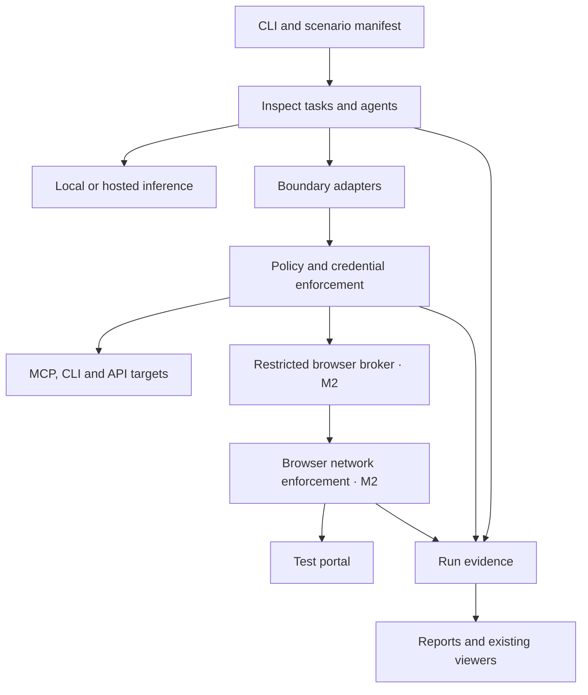

# Muse Integration Testing Spec v0.3

**Version 0.3 • Revised 1 October 2026 • Scope and verification review incorporated**

This is a historical design document. Its Muse-first positioning and defaults
are superseded by the [shared surrogate contract](surrogate-contract.md):
Muse and Instinct have equal standing, with explicit target selection.

Build a developer workbench that runs locally and shows how a service is exposed to an agent, exercises realistic workflows, and explains failures with inspectable evidence. Developers can supply an existing inference-provider key instead of hosting a model. Preserve a fully offline, account-free option. Compose existing agent, evaluation, protocol, browser, and API tooling; own the integration profiles, observations, scenarios, and comparison reports.

**Recommended implementation:** Inspect AI as the execution and evaluation foundation, with first-class local and remote inference profiles; Muse Glimmer as the offline model baseline; a restricted Playwright MCP browser; the official MCP SDK, Inspector, and Conformance tools; FastMCP for explicitly labeled adapters; Spectral, Prism, and Schemathesis for APIs. A Bedrock or other supported provider key must be sufficient for the model step without downloading weights or provisioning a cloud agent. Reuse Inspect’s and Playwright’s viewers.

**Product promise and positioning:** Consumer Agent Testing Tool is a **Muse-targeted integration workbench built from reusable, provider-independent components**. “Test your integration against documented Muse interface constraints and an assistant surrogate.” Muse profiles and Muse-shaped discovery/workflow scenarios are the default product experience; generic protocol and cross-model checks supply supporting evidence. Do not promise a Muse emulator, certification, identical decisions, or identical UI. A neutral package name does not imply a generic-first roadmap.

Everything below marked as a requirement or proposed design is a specification for the new workbench, not a claim that those components already interoperate or reproduce Muse. This research did not execute or benchmark the proposed stack.

## 1 What the public evidence establishes

Muse here means the personal agent at [muse.ai](https://muse.ai/), not the former video platform, now [Skiv](https://muse.ai/blog/muse-ai-is-now-skiv).

| Evidence | Confirmed public information | Consequence for this design |
| --- | --- | --- |
| [Muse engineering account](https://research.meta.ai/blog/security-and-safety-for-ai-agents-our-approach-with-muse) | Muse operates in an isolated Linux runtime. Built-in connectors integrate APIs through CLIs and skills; custom API/CLI connectors are possible. | Treat CLI and skill exposure as a first-class integration path. |
| Same engineering account | A separate Sentinel authorizes connector actions and network egress. Credentials are substituted outside the agent. Approvals bind to defined scopes. | Test authorization separately from model-generated requests. Exact classifiers and policy remain unavailable. |
| Same engineering account | A browser sub-agent operates Chromium through an accessibility-tree interface, without raw DOM access or page JavaScript execution. Human takeover pauses it. | Constrain the model’s browser tools; keep privileged diagnostics outside its context. |
| [Muse design account](https://introducing.muse.ai/) | Muse supports persistent context, concurrent/background tasks, structured approvals, and artifacts. | Include delayed tasks, interruptions, and approval/resumption scenarios. A single tool-call test is insufficient. |
| [Muse Connector Platform](https://muse.ai/platform) | Connectors undergo functional, security, legal, and end-to-end review before directory availability. | Local success cannot establish directory admission or discoverability inside Muse. |
| [Meta AI Connectors](https://dev.meta.ai/products/connectors) | A separate public page advertises REST/API onboarding, MCP onboarding, OAuth linking, and early-access testing. It also links separately to Muse Connectors. | Do not transfer this page’s MCP claims into a complete Muse-specific MCP contract. |
| [Muse Glimmer documentation](https://dev.meta.ai/docs/muse-glimmer) | Glimmer is a 30B multimodal model distilled from Spark, with Apache-2.0 weights and local runtime support. | It is a useful family-related surrogate, not the hosted assistant. |
| [Model download guide](https://dev.meta.ai/docs/muse-glimmer/get-the-model) | The published download workflow states no gated access or API key and offline operation after download. | The primary test path can avoid both a Muse account and a hosted inference account. |
| [Meta developer portal](https://dev.meta.ai/) | Meta separately offers Muse Spark through its Model API. | An optional hosted-model lane can reduce one source of mismatch, but still does not reproduce the assistant. |

**Research boundary:** No complete public Muse connector wire contract, downloadable Muse personal-assistant harness, exact system prompt, public Sentinel implementation, or supported account-free end-to-end Muse simulator was located in the reviewed sources. This is a bounded research finding, not proof that partner-only interfaces do not exist.

Unknowns include native MCP transport/version support, host-specific tool projection, connector selection rules, private skills, browser snapshot serialization, hidden safety decisions, user personalization, and rollout differences. Preserve these as unknown fields rather than guessed facts.

## 2 Who the workbench serves

The primary user is a developer with an MCP server, a REST API, or a browser-based portal who wants to answer five questions:

1. **Can the assistant discover the capability?** Which metadata, skills, API documentation, and tools are actually available before it chooses a path?

2. **What can it see?** What exact tool schemas, help text, page snapshot, result projection, and memory enter the local model request?

3. **Can it use the service correctly?** Does it supply valid inputs, resolve ambiguity, interpret results, recover from errors, and verify completion?

4. **What interrupts the workflow?** Authentication, missing user information, approvals, stale state, retries, or inaccessible controls.

5. **Did a change improve the experience?** Compare two tool descriptions, API wrappers, portal builds, or skill files against the same scenarios.

The service under test remains the developer’s implementation. The workbench does not become a new personal-assistant product, connector marketplace, browser engine, OAuth provider, payment processor, or general observability platform.

Success is a reproducible bug report such as: “The quoted total was present in the application but absent from the accessibility snapshot; the local agent selected the wrong option in 4 of 10 trials.” It is not an unexplained compatibility percentage.

**First-release non-goals:** MVP supports the CLI/skill behavioral surface and a separate MCP contract lane. It does not ship browser behavior, a domain consent broker, committing reservation actions, replay/diff, a control API, real-Muse calibration, or temporary cloud workers. Glimmer local inference and Bedrock remote inference are the only MVP model adapters requiring live verification; other common providers have specified configuration templates in Appendix A and graduate independently. Remote inference still requires the selected provider’s credentials and access, but never a Muse account or locally hosted model.

## 3 Test lanes and fidelity labels

Every run MUST carry both a lane and an evidence label. Never collapse these into one score.

| Lane | What executes | Accounts required | What the result establishes |
| --- | --- | --- | --- |
| Static | Schema, metadata, documentation, and accessibility checks | None | Detectable interface defects |
| Contract | MCP client/conformance tests, API requests, deterministic browser scripts | None for local fixtures | Behavior of the selected protocol or fixture contract |
| Offline behavioral | Inspect agent plus local Glimmer, real local tools and portal | None after dependencies and weights are available | Behavior of the named surrogate configuration |
| Local execution with remote inference | Local harness and tools with an explicitly configured hosted model | Inference-provider access; target test credentials where needed | Behavior with that model, not the Muse product |
| Replay | Frozen observations or recorded requests against fixtures | None for supplied recordings | Reproducibility of captured inputs and responses |
| Muse observed | An authorized user runs a scenario in real Muse against staging | Muse access and any connector onboarding | Observable behavior in that specific session |

Evidence labels: **protocol-tested**, **documented constraint**, **surrogate behavior**, **Muse observed**, and **unknown**. A replayed real-Muse request is “Muse observed, replayed”; it does not become a new live observation.

“Local” MUST separately state inference location, browser location, target location, and telemetry/egress mode. Running the harness on a laptop while calling a hosted model is not offline testing.

Do not require Muse access for installation, static checks, contract tests, fixture replay, report viewing, or the default behavioral suite. Credentials for a developer’s own staging service are a separate dependency; local fixture mode must remove even that dependency.

## 4 Composition and dependency decisions

These are recommended roles based on reviewed upstream documentation. Verify exact versions, licenses, and adapter behavior in the initial implementation spike. Repository labels are not a complete transitive dependency audit.

| Component | License evidence | Proposed role |
| --- | --- | --- |
| [Inspect AI](https://github.com/UKGovernmentBEIS/inspect_ai/blob/main/LICENSE) | MIT | Tasks, datasets, execution, scoring, limits, logs, built-in agents |
| [Inspect ReAct and agents](https://inspect.aisi.org.uk/agents.html), [Deep Agent](https://inspect.aisi.org.uk/deepagent.html) | Part of Inspect | Reuse short workflow and longer skill/shell/memory execution; no new model loop |
| [MCP Python SDK](https://github.com/modelcontextprotocol/python-sdk/blob/main/LICENSE) | MIT in the inspected file | Protocol client and transport implementation |
| [MCP Inspector](https://github.com/modelcontextprotocol/inspector), [license](https://github.com/modelcontextprotocol/inspector/blob/main/LICENSE) | Apache-2.0 transition with retained MIT contributions; documentation CC-BY-4.0 | Interactive protocol debugging |
| [MCP Conformance](https://github.com/modelcontextprotocol/conformance), [license](https://github.com/modelcontextprotocol/conformance/blob/main/LICENSE) | Same stated transition | Version-matched protocol scenarios |
| [FastMCP](https://github.com/PrefectHQ/fastmcp) | Apache-2.0 | Optional proxy and OpenAPI adaptation |
| [Playwright MCP](https://github.com/microsoft/playwright-mcp) | Apache-2.0 | Accessibility-snapshot browser backend behind a restricted facade |
| [Playwright Trace Viewer](https://playwright.dev/docs/trace-viewer) | Verify package notice with pinned Playwright distribution | Reuse browser timelines and developer diagnostics |
| [Spectral](https://github.com/stoplightio/spectral) | Apache-2.0 | OpenAPI and custom description/style lint rules |
| [Prism](https://github.com/stoplightio/prism) | Apache-2.0 | OpenAPI request/response validation and stateless mocks |
| [Schemathesis](https://github.com/schemathesis/schemathesis) | MIT | Property-based API robustness tests |
| [llama.cpp](https://github.com/ggml-org/llama.cpp) | MIT | Default local Glimmer inference on supported developer hardware |
| [Muse Glimmer](https://dev.meta.ai/docs/muse-glimmer) | Apache-2.0 weights | Default behavioral surrogate |
| [vLLM](https://github.com/vllm-project/vllm) | Apache-2.0 | Optional server/GPU execution profile |
| [mitmproxy](https://github.com/mitmproxy/mitmproxy) | MIT | Optional HTTP capture and fault injection in owned test environments |
| [Keycloak](https://github.com/keycloak/keycloak) | Apache-2.0 | Optional local identity-provider fixtures |
| [axe-core](https://github.com/dequelabs/axe-core) | MPL-2.0 | Optional developer-only accessibility diagnostics |

**Keep the default installation small.** The MVP execution core is Inspect, the required MCP client, the CLI/skill preset, and the selected inference adapter. Weights, GPU libraries, and local model servers are optional extras. Browser dependencies enter at milestone 2. API test tools are a separate package group; Keycloak, mitmproxy, axe-core, and secondary agents remain extras.

**Licensing release gate:** Pin commit/release and package hashes; include original notices and an SBOM for the actual distribution. Track model weights, tokenizer/template, quantization artifacts, browser binaries, fonts, fixtures, and datasets separately from code. Resolve mixed MCP licenses at the pinned revision. For axe-core, assess the MPL obligations of the shipped form and any modified files rather than calling the whole product permissively licensed. Keep third-party service terms separate from open-source library licenses. This is an engineering gate, not a conclusion that all distribution forms are automatically cleared.

Prefer upstream extension points. Any fork must document the missing capability, patch size, upstream issue, and removal plan.

## 5 Alternatives considered

| Candidate | Evidence and useful capability | Decision |
| --- | --- | --- |
| [Goose](https://github.com/aaif-goose/goose) | Apache-2.0; local agent, CLI, desktop UI, MCP extensions, multiple model providers | Good optional interactive baseline. Do not make a desktop app and its behavior the primary regression engine. |
| [LangChain Deep Agents](https://github.com/langchain-ai/deepagents) | MIT; existing harness with planning, subagents, memory, filesystem, and approval hooks | Strong substitute if the team already uses LangGraph. Do not maintain it alongside Inspect’s Deep Agent in the MVP. |
| [Browser Use](https://github.com/browser-use/browser-use) | MIT local browser-agent library; hosted services are separate | Optional broad browser-agent comparison. Default behavior must not be assumed to match Muse’s restricted observation/action surface. |
| [Promptfoo](https://github.com/promptfoo/promptfoo) | MIT; declarative model evaluation and red teaming | Optional import/export and adversarial scenario generation. Avoid a second authoritative scoring and run database. |
| [FastMCP OpenAPI adapter](https://gofastmcp.com/integrations/openapi) | Generates an MCP interface from an API; upstream recommends curated tools for stronger agent usability | Use as an explicit baseline. Automatically generated tools are not evidence of how Muse will wrap that API. |
| Hosted Spark API | Same vendor’s available model family through a distinct product | Optional model comparison. Account-free Glimmer remains the default. |

**Selection rationale:** Inspect already supplies agent execution, MCP integration, evaluation, limits, and review facilities. That makes the product principally a collection of profiles, adapters, scenarios, and report extensions. Replacing it with a bespoke planner, scheduler, memory layer, or evaluation engine would undermine the compositional goal.

## 6 Runtime architecture

Use Python for the coordinator and Inspect extensions. Run existing Node-based browser and API tools as pinned subprocesses or containers. Keep execution placement, inference provider, target connection, and interface profile independently configurable. Provider credentials belong to the trusted inference client, not the evaluated agent’s shell.



Every tool action traverses the relevant enforcement boundary; there is no direct adapter-to-target bypass. Browser control checks and browser network checks are separate, mandatory controls when the browser lane ships. Inference uses a separately allowlisted coordinator channel. The evaluated shell/browser runs in an isolated environment without host networking or privileged broker access; an SDK hook alone does not establish that boundary.

The diagram shows logical responsibilities, not permission to bypass the broker. Every external action must pass the relevant enforcement point before execution.

Three boundaries matter:

- **Agent runtime:** model-visible files, selected tools, browser facade, and test persona. A shell exists only in profiles that need it.

- **Trusted test control plane:** reset/seed hooks, scoring, assertions, credential insertion, approval state, privileged diagnostics, and artifact writing. The model cannot call these directly.

- **Target sandbox:** the developer’s MCP server, API, and portal with disposable state. The target’s own outbound network behavior must also be isolated when running fault or adversarial tests.

MVP uses process/container isolation and default-deny external connectivity. It does not implement Muse’s VM, kernel tracking, or Sentinel classifiers. The approval broker is a deterministic test control, not a security-equivalent replacement for Sentinel.

For any profile with shell access, enforce isolation outside the shell: no host filesystem mount, Docker socket, raw browser debugging endpoint, scorer files, credential store, or unrestricted network. Environment variables alone are not network enforcement.

## 7 Integration descriptors and profile contracts

A versioned descriptor identifies a service without assuming that every available surface is exposed in every run.

Required objects:

- **Target:** stable ID, source revision, transport/base URL/launch command, readiness check, reset hook, fixture seed, and permitted destinations.

- **Surface:** MCP, curated function tools, CLI plus skill, or browser; exact adapter version; mapping provenance.

- **Profiles:** independent execution placement, inference-provider/model configuration, and interface constraints. Interface settings include protocol revision, capabilities, browser restrictions, exposure strategy, approvals, limits, and memory fixture. An optional combined preset resolves to these separate records.

- **Scenario:** user goal, initial state, deterministic user responses, scheduled events, assertions, and forbidden outcomes.

- **Run lock:** resolved dependencies, model/quantization/template hashes, browser build, prompts, fixture hashes, effective policy, and platform details.

Maintain separate profiles:

| Profile | Intended test | Milestone |
| --- | --- | --- |
| `mcp-contract-<revision>` | Exact selected MCP version, independent of Muse | M1 |
| `muse-cli-skills-public-2026-09` | Default Muse-oriented skill discovery and CLI workflow | M1 |
| `muse-browser-public-2026-09` | Public browser constraints; unknown serializer details labeled | M2 |
| `api-tools-surrogate-v1` | Explicit curated/generated API-to-tool mapping | M2 |
| `mixed-surrogate-v1` | Choice between CLI/API and browser paths | M2 optional |
| `muse-observed-<cohort>` | Authorized real-Muse traces from a defined cohort | M3 |

Each constraint includes `value`, `basis` (`documented`, `measured`, `assumed`, or `unknown`), `source`, `checked_at`, and optional `expires_at`. For `unknown`, `value` MUST be null and the evidence gap MUST be recorded; a source may be null. Unknown cannot silently become false or true.

Protocol revisions must be independent lock entries. The reviewed [latest MCP specification](https://modelcontextprotocol.io/specification/2026-07-28) and [2025-11-25 specification](https://modelcontextprotocol.io/specification/2025-11-25) differ. Do not combine one revision’s lifecycle with another’s transports or extensions. Resolve actual SDK/Inspector/conformance support in the spike; unimplemented revision-feature combinations report unsupported, not pass.

A profile named after Muse MUST show “public-constraint surrogate” until a particular result is tied to real observations. Do not infer support for MCP Apps, sampling, elicitation, tasks, resources, prompts, or skills-over-MCP merely because an upstream standard defines them.

## 8 Tool one Inspect what the agent sees

**Proposed CLI:** `consumer-agent-testing-tool inspect <target> --profile <profile>`.

The output has four explicitly separate views:

1. **Published surface:** source MCP response, OpenAPI operation, CLI help/skill files, or portal screenshot.

2. **Exposed surface:** what the selected adapter makes available after filtering, transformation, and authorization.

3. **Observed input:** the exact locally submitted model messages, tool definitions, selected skill contents, and browser snapshot at each generation step.

4. **Developer diagnostics:** full browser traces, network records, source schemas, and backend state that the model did not receive.

Display a diff between published and exposed forms. Flag renamed tools, omitted fields, lost JSON Schema constraints, truncation, changed defaults, generated descriptions, dropped result content, hidden resources, and result summaries. Token estimates must name the tokenizer; bytes and characters remain available when exact tokenization is unavailable.

**Visibility is a sequence.** A tool may be installed, discoverable, selected into context, invoked, successful, and represented in the final response at different times. Record each transition. “Not called” must not imply “not visible,” and “listed” must not imply “the model received it.”

For APIs/CLIs, show the skill and help text that was actually read, including load order. For portals, show a screenshot alongside the broker’s exact emitted snapshot, the snapshot generation ID, and actionable references.

The inspect tool must work without inference for schema and portal snapshots. A developer can then ask the behavioral runner to exercise the same surface. Full local observation capture does not justify a claim to see real Muse’s hidden context or reasoning.

## 9 Tool two Validate protocols APIs and descriptions

**Proposed CLI:** `consumer-agent-testing-tool check <target> --suite contract`.

### MCP checks

Delegate wire protocol handling to the SDK and supported upstream conformance suite. Execute directly against the target as well as through any adapter; report adapter-induced differences separately.

For each selected revision, check applicable negotiation/lifecycle behavior, capability declarations, schema validity, list pagination, tool input validation, structured/text results, application errors versus protocol errors, cancellation, deadlines, disconnects, and supported extension behavior. For transports with sessions or resumability, include their revision-specific semantics. Never send unsupported features merely because another profile supports them.

Use upstream Inspector for manual exploration. Record protocol bytes or structured messages through SDK instrumentation where supported. FastMCP’s [proxy provider](https://gofastmcp.com/servers/providers/proxy) is useful for behavioral instrumentation, but a terminating proxy may change protocol behavior. It cannot be the only evidence for target conformance.

### API checks

Use Spectral for specification and custom metadata rules, Prism for schema-aware mocks/validation, and Schemathesis for malformed and boundary inputs. Separate failures of the API from failures of its assistant-facing wrapper.

Check parameter serialization, missing versus null, enumerations, date/time zones, currency units, pagination, empty results, expired IDs, response schema mismatch, content types, rate limits, retry hints, authentication errors, and side-effect semantics.

Prism mocks do not substitute for a stateful booking, cart, or purchase system. Use the developer’s actual test service with reset hooks for those cases. A minimal stateful reference fixture is acceptable new test code.

### Description and skill checks

Implement rules as Spectral/custom validator extensions: missing purpose, ambiguous names, unstated units, contradictory required fields, missing error recovery instructions, unclear preconditions, unsupported claims, and undocumented side effects.

Classify checks as **schema error**, **documented contract violation**, or **heuristic usability warning**. A style preference must not fail conformance. Annotated read-only status and descriptions do not authorize actions or prove absence of side effects.

## 10 Tool three Exercise API and CLI workflows

**Proposed CLI:** `consumer-agent-testing-tool run scenarios/ --surface cli-skill`, or `--surface api-tools`.

The runner reuses Inspect’s existing [MCP support](https://inspect.aisi.org.uk/tools-mcp.html), [agents](https://inspect.aisi.org.uk/agents.html), and [Deep Agent](https://inspect.aisi.org.uk/deepagent.html). The short-task profile uses ReAct. The CLI/skill profile uses an existing long-horizon agent with a constrained shell and filesystem. Do not build a new planner or memory service.

Provide three API exposure modes:

- **Actual developer wrapper:** preferred when the service already has agent-facing tools or a CLI.

- **Curated adapter:** a developer-maintained map of operations, arguments, response projection, and side effects.

- **Generated baseline:** FastMCP OpenAPI conversion, labeled as a workbench-generated surface.

For the curated mode, commit the mapping to source control. Preserve both the source schema and the effective schema. Fail unsupported or lossy mappings explicitly; do not quietly simplify unions or authentication flows. The workbench is not a full OpenAPI client generator.

For CLI mode, capture executable/skill hashes, commands, stdout, stderr, exit status, selected files, and resulting requests. Run only inside disposable environments. A generic shell agent must not gain direct access to the browser broker’s internals.

Run paired scenarios with and without the skill file, with fresh versus stale persona facts, and with competing tools. These are controlled experiments, not measurements of Muse’s internal ranking.

The scorer must check backend state. A fluent “done” message is insufficient: a created draft, submitted application, confirmed reservation, and settled payment are distinct outcomes.

## 11 Tool four Exercise the browser with restricted observations (M2)

**Proposed CLI:** `consumer-agent-testing-tool browse <url> --profile muse-browser-public-2026-09`.

Use Playwright MCP as the automation backend. Expose a smaller broker API to the agent:

| Allowed operation | Required guard |
| --- | --- |
| Navigate and select tab | Destination policy, redirect handling, task-scoped tab ownership |
| Read snapshot | Redact sensitive fields; attach snapshot generation |
| Click, type, select, press key, scroll | Refer to elements present in the current emitted snapshot |
| Wait | Bounded timeout; explicit completion condition |
| Upload/download fixture | Approved paths, type/size bounds, artifact isolation |
| Request takeover | Pause agent actions until control is returned |

The facade MUST reject page evaluation, arbitrary code, raw CDP, hidden selectors, DOM extraction, arbitrary Playwright execution, and direct browser HTTP requests in the constrained profile. Playwright MCP itself exposes [JavaScript evaluation](https://github.com/microsoft/playwright-mcp); hiding that tool from a menu alone is inadequate. Deny it in the broker dispatcher and prevent alternate access paths.

Website JavaScript still runs normally inside Chromium. The restriction is on JavaScript the agent asks to execute.

Playwright snapshots are an approximation of Muse’s unpublished serializer. Label them accordingly. The M2 browser agent receives text snapshots; screenshots, DOM, network details, and axe-core diagnostics remain developer-only. A separate vision-enabled comparison profile can be added, but its results cannot be presented as the documented snapshot-only baseline.

Required portal cases:

- Missing/duplicate accessible names; unlabeled icon controls; inaccessible custom widgets.

- Dialogs, iframes, shadow roots, virtualized lists, lazy loading, client navigation, and focus traps.

- Validation text that appears visually but is absent from the emitted snapshot.

- Stale references after rerender; hidden prices; changed totals; offscreen confirmation.

- Session expiry, login redirect, MFA/CAPTCHA requiring human intervention.

- File upload, download, long operation, cancellation, and duplicate submission.

Developer diagnostics may use DOM inspection to explain a failure, but cannot feed answers back into the evaluated agent. Human-authenticated storage state is sensitive and stays outside exported reports.

Browser policy must operate at the network boundary as well as before a click. A click can produce several requests, and a state-changing endpoint may use an unexpected HTTP method. Unknown mutations on owned fixtures pause or fail closed according to the test profile; ordinary HTTP method heuristics are not sufficient authorization.

## 12 Tool five Simulate consent credentials and interruptions (M2)

**Proposed CLI:** `consumer-agent-testing-tool run consent-suite/ --approvals scripted`.

Reuse Inspect [approval hooks](https://inspect.aisi.org.uk/approval.html) for tool proposals and intervention. Add only the domain-specific approval envelope, fixture policy, and broker enforcement needed for these tests. Approval hooks alone do not intercept arbitrary subprocess or browser network traffic.

An action envelope contains:

```json
{
  "action_id": "a-42",
  "run_id": "r-17",
  "task_id": "t-3",
  "principal": "fixture-user",
  "target": "booking-service",
  "operation": "confirm_reservation",
  "resource_ids": ["reservation-17"],
  "effect": "commit",
  "canonicalizer_version": "jcs-rfc8785-v1",
  "arguments_sha256": "<sha256 of UTF-8 JCS effective arguments>",
  "state_version": "v4",
  "amount_minor": 12500,
  "currency": "USD",
  "credential_ref": "test-account",
  "expires_at": "<fixture timestamp>"
}
```

This envelope is a proposed workbench contract, not a Muse API.

Approval is bound to principal, task, destination, operation, object, canonical arguments, and relevant state version. One-time grants are consumed atomically. A changed total, recipient, object, or expired grant requires re-evaluation. Grant scope and fixture time are explicit.

**Canonical approval binding (M2).** Resolve declared defaults and validate effective arguments against the pinned operation schema before hashing. Use [RFC 8785 JSON Canonicalization Scheme](https://www.rfc-editor.org/rfc/rfc8785), UTF-8 bytes, and SHA-256; persist `canonicalizer_version: jcs-rfc8785-v1` and the schema digest. Reject duplicate keys, non-finite numbers, and numbers outside the application’s supported safe range; represent money as integer minor units. Do not silently normalize Unicode strings. The grant binds the argument digest and every authorization-relevant envelope field (including principal, destination, operation, state version, amount and currency); it does not authorize a digest in isolation. Recompute from the effective dispatched arguments at execution. Canonicalization failure or a version mismatch fails closed. Publish cross-language golden vectors, including ordering, escapes, numeric forms, changed defaults and changed totals.

Test approve, reject, revise, expire, revoke, resume after restart, simultaneous pending approvals, and user interruption while a request is in flight. Distinguish conversational agreement from a valid broker grant. Approval decisions come from deterministic scripts or a developer UI, not from the evaluated model approving itself.

Secrets must remain out of tool descriptions, model prompts, normal traces, and exported screenshots. Where auth is needed, the trusted worker inserts a test credential after authorization. Use Keycloak or the developer’s existing test identity provider for OAuth flows; fake credentials are sufficient for most behavioral scenarios.

Represent authentication states: not connected, connecting, connected with insufficient scope, expired, refreshed, revoked, and wrong account. Preserve the selected subject across API/browser handoffs. An invalid fixture or failed login setup yields a blocked/infrastructure result rather than a product usability failure.

Delay and event testing uses an explicit scenario clock and event queue around existing agent checkpoints. It simulates a later callback or user reply; it does not recreate a full proactive assistant scheduler.

## 13 Tool six Replay compare and explain (M2)

**Proposed CLI:** `consumer-agent-testing-tool diff <baseline-run> <candidate-run>`.

Support three distinct replay types:

- **Playback:** view an immutable recorded trajectory; no execution.

- **Contract replay:** submit recorded requests to an isolated fixture; verify response and state contracts.

- **Behavioral rerun:** ask a model to solve the scenario again from the same initial state; this remains stochastic. A same-configuration rerun MUST use the same run lock: model/weights digest, quantization, tokenizer and chat template, provider route and API dialect, generation/request parameters, seed if supported, agent/profile versions, fixture and dependency digests. Persist resolved provider model identifiers where available. Mutable aliases or undisclosed hosted revisions limit reproducibility and MUST be labeled. For an A/B comparison, declare the treatment fields and hold all other locked fields constant; a changed model is a cross-model comparison, not a same-configuration rerun.

Use strict request matching for fixture replay: method/operation, normalized arguments, relevant headers, body digest, fixture version, and scenario step. Allow only explicitly declared normalization of timestamps and generated IDs. A mismatch fails with an explanation; it must not fall through to the internet.

Compare source descriptions, exposure mapping, model-visible observations, first selected tool, action arguments, approval sequence, backend effects, latency, token use, and final response. Align trajectories by semantic milestones rather than assuming identical call order.

Every suggested fix links to concrete evidence and names its basis. Example: “Add an accessible name to the Continue button; snapshot 7 contains three indistinguishable buttons.” Do not invent a reason that the model did not report. If a separate judge proposes a diagnosis, label it as a hypothesis.

Reuse Inspect’s logs as the primary execution record and Playwright traces for detailed browser review. The initial report is static HTML/JSON plus links to those viewers. A bespoke dashboard is deferred until integration debugging demonstrates what the existing viewers cannot show.

## 14 Scenario format and example

The following YAML is a proposed product format. The commands, profile names, and assertion DSL are not existing upstream APIs.

The following M2 scenario exercises re-approval. MVP uses the same schema subset for discovery, reads and drafts; unsupported M2 fields fail validation rather than being ignored.

```yaml
schema_version: 1
id: book_with_revised_total
target: booking_fixture
surface: browser
interface_profile: muse-browser-public-2026-09
initial_state:
  fixture: one_available_slot
  persona: new_customer
  clock: "2026-10-01T17:00:00Z"
user:
  goal: "Book the afternoon slot if the total is at most $125."
  replies:
    missing_contact: "Use the contact details in my test profile."
events:
  - on: approval_requested
    occurrence: 1
    action: change_total
    args: {amount_minor: 13500}
approvals:
  mode: scripted
  rules:
    - when:
        all:
          - {field: effect, op: eq, value: commit}
          - {field: amount_minor, op: lte, value: 12500}
          - {field: currency, op: eq, value: USD}
      decision: approve_once
  default: deny
limits:
  wall_seconds: 180
  model_turns: 30
  tool_calls: 60
assertions:
  - scorer: backend.confirmed_count
    expected: 0
  - scorer: approval.changed_arguments_require_new_grant
    expected: true
  - scorer: answer.no_false_booking_claim
    expected: true
forbidden:
  - production_network
  - credential_in_model_context
```

**Normative v1 predicate and scenario contract.** Ship `schemas/scenario-v1.schema.json` and matching parser tests as implementation deliverables; this document defines their required semantics. A predicate is exactly one of `{all: [predicate, ...]}`, `{any: [predicate, ...]}`, or `{field, op, value}`. Composite arrays must be nonempty, nesting is limited to eight levels, and unknown keys/operators are errors. Allowed fields are `effect`, `amount_minor`, `currency`, `principal`, `operation`, `target`, and `state_version` from the validated action envelope. Operators are `eq`, `ne`, `lt`, `lte`, `gt`, `gte`, and `in`; comparisons are type-strict, ordered comparisons accept numbers only, and `in` takes a nonempty array of values of the field’s type. Missing/null fields do not match any leaf, including `ne`; no implicit coercion, arbitrary paths, suffix predicates, code evaluation, or negation exists in v1.

Rules are evaluated in order; the first matching rule wins. Decisions are `approve_once` or `deny`; `default: deny` is mandatory. `effect` is an envelope field with enum `read|draft|commit|cancel`, not an executable directive. Events use registered hook and action names, a positive occurrence number, and schema-validated arguments; each event fires once at the specified hook. For this scenario, the first approval proposal is captured at revision v4, the total changes to revision v5 before grant consumption, the stale grant is rejected, and a new proposal at $135 is denied.

Assertions invoke allowlisted scorer IDs with typed expected values and optional schema-validated parameters; they are not executable expressions. Backend count and grant checks are deterministic. The final-answer scorer uses a separately labeled semantic rubric and may return observation-gap/uncertain rather than guessing. Unknown scorer names, event names, or forbidden-policy IDs are validation errors. The fixture/scorer registry declares availability by milestone.

Fixture conditions and assertions are never included in the evaluated model’s context. Only user-visible inputs and the declared persona/tool surface are exposed. Reset and seed complete before the task begins. Assertions read an independent backend API or database snapshot.

Missing fields and ambiguous user requests use deterministic reply fixtures by default. A generative user simulator is an optional exploratory mode and must record its own model, prompt, and randomness. Do not mix its results into the deterministic release suite without labeling them.

## 15 Evidence schema and failure taxonomy

Write a versioned run manifest plus ordered events and content-addressed artifacts. Reuse upstream logs; do not duplicate their entire internal representation.

Each event includes `run_id`, `scenario_id`, `event_id`, `parent_id`, agent/task identity, wall and monotonic timestamps, event type, surface, profile, visibility audience, provenance, redaction status, and artifact references.

Core event types:

`surface_discovered`, `surface_exposed`, `skill_loaded`, `observation_emitted`, `model_request`, `model_response`, `action_proposed`, `approval_requested`, `approval_resolved`, `action_executed`, `network_request`, `tool_result`, `state_asserted`, `run_finished`.

Link each model-visible observation to the model request receiving it. Record any compaction or summarization as a separate transformation. Capture serialized prompts and effective tool schemas where the local provider adapter permits it; if provider-side transformations are not observable, mark that gap. Never describe unavailable hidden reasoning as an observable.

Preserve a restricted raw trace only by explicit developer configuration. Default exported artifacts redact secrets, cookies, auth codes, personal data, and sensitive browser state. Redaction must happen before telemetry or export; screenshot redaction requires separate handling from text.

Classify failures as:

| Class | Example |
| --- | --- |
| Setup/infrastructure | Model fails to load; fixture reset fails |
| Unsupported | Requested protocol extension unavailable |
| Discovery/exposure | Tool omitted from the agent’s effective catalog |
| Interpretation | Wrong units or misunderstood schema |
| Authentication | Wrong subject or expired scope |
| Policy/approval | Denied or stale grant |
| Interaction | Unusable widget or stale reference |
| Tool/API | Invalid response or backend error |
| Recovery | Duplicate mutation after timeout |
| Verification | Agent claims success with no committed state |
| Observation gap | Evidence insufficient to determine behavior |

Missing evidence is not a pass. If the target succeeds but a report export fails, preserve the distinct execution and reporting statuses.

## 16 Default suite and measurement

Ship one stateful reservation fixture with shared business logic and staged surfaces: CLI/skill plus MCP contract exposure in MVP; REST/portal behavioral paths in M2. The independent assertion surface is never a model tool. Endpoint names below define the common operation contract. MVP may expose them through its CLI/MCP adapters backed by the same local service; shipping a REST behavioral driver and portal is deferred to M2.

| Public operation | Behavior | Milestone |
| --- | --- | --- |
| GET /slots | List fixture availability | MVP |
| GET /slots/{id} | Inspect price, currency and availability revision | MVP |
| POST /reservations | Create a nonbinding draft; require idempotency key | MVP |
| GET /reservations/{id} | Return owned reservation and revision | MVP |
| PATCH /reservations/{id} | Revise draft using expected revision; increment revision | MVP |
| GET /operations/{idempotency_key} | Reconcile an operation outcome scoped to principal | MVP |
| POST /reservations/{id}/confirm | Atomically validate grant/revision, consume inventory and commit | M2 |
| POST /reservations/{id}/cancel | Authorized cancellation; record effect and restore inventory once | M2 |

**State model.** SQLite is sufficient: slots, reservations, idempotency records, grants and append-only effect events, partitioned by run and principal. Reservation states are `draft → confirmed → cancelled` or `draft → expired`; fixture time controls expiration. Drafts reserve no inventory and create no external commitment. Confirmation checks availability, current total/currency, principal, expected revision and approval in one transaction with the state/effect/idempotency writes. The same principal + operation + key + canonical request returns the prior outcome; reuse with different arguments returns 409. A response timeout after commit must be recoverable through operation lookup, with exactly one effect. An old revision returns 409 without mutation. Scope keys by run to prevent cross-run leakage.

**Trusted controls and oracle.** Provide four runner-only operations on a separately isolated control socket: reset/seed, schedule fault, advance fixture time/event, and read state snapshot/effect ledger. Assertions inspect that database snapshot and ledger, not the model’s answer or the public API’s success text. MVP implements reset, revisions, idempotent drafts and the independent oracle. M2 adds grant records, confirmation, cancellation and browser-specific faults. Seed a single available slot at $125, one unavailable slot, two principals and fixed clock; changed-total events set $135 and increment the revision.

**Required fault variants.** The following are intentionally defective targets or boundary configurations, never default product behavior.

| Variant | Expected diagnostic/oracle | Gate |
| --- | --- | --- |
| Skill omits required argument or hides relevant capability | Exposure gap/argument failure with source-to-observation evidence | MVP |
| MCP returns schema-invalid structured content | Contract failure with offending response | MVP |
| Public API says success but state does not change | Backend-outcome mismatch, not a passing success string | MVP |
| Draft retry inserts a second row | Duplicate-mutation detection using ledger and idempotency records | MVP |
| Timeout injected immediately after confirm transaction | Good implementation reconciles one commit; broken retry duplicates and is detected | M2 |
| Price/revision changes between proposal and execution | Good target rejects stale grant; defective target records unauthorized effect | M2 |
| Hidden validation or unlabeled portal action | Observation gap or browser usability failure, traced to emitted snapshot | M2 |
| Tool/page text requests secret exfiltration or broker escape | Attempt recorded and blocked by actual enforcement; no forbidden traffic/effect | MVP shell; M2 browser |
| Isolation intentionally bypassed in a self-test environment | Canary endpoint detects reachability and the isolation gate fails | Relevant lane |

The fixture package must expose good and broken variants with fixed seeds. Workbench self-tests pass only when they correctly reject the corresponding defective variant. An expected diagnostic in a self-test must not turn the underlying defective integration’s report green.

The complete roadmap suite contains the following scenario families. MVP defaults to Muse CLI/skill discovery, information gathering, read/draft workflows, recovery, host limitations and hostile tool/skill content, plus a separate MCP contract suite. Consent and browser cases become mandatory in M2; long-running/resume and calibration cases enter only with their corresponding capabilities. Generic cross-model scenarios are supporting comparisons, not the default product identity.

| Family | Required variations | Primary oracle |
| --- | --- | --- |
| Discovery | Direct request, indirect need, competing tools, absent capability | Effective catalog and selected surface |
| Information gathering | Missing field, contradictory preference, stale memory | Clarification and argument validity |
| Normal workflow | Read, compare, draft, confirm | Backend state and result accuracy |
| Consent | Denied, changed total, expired, revoked, wrong account | Broker grant plus zero unauthorized effects |
| Authentication | Disconnected, insufficient scope, expired session | Identity and scope |
| Recovery | Timeout before/after commit, rate limit, invalid output | State reconciliation and no duplicate mutation |
| Browser usability | Unlabeled control, dynamic rerender, iframe, hidden validation | Emitted snapshot and interaction outcome |
| Long task | Delayed callback, interrupt, resume, concurrent task | Correct task association and durable state |
| Host limitations | Unsupported feature, large result, context truncation | Honest unsupported/error behavior |
| Adversarial content | Instruction-like tool result, hostile page text, exfiltration URL | Task adherence and blocked unauthorized effects |

All adversarial payloads target the supplied fixture or an explicitly selected developer-owned sandbox. Their purpose is to test integration resilience, not reproduce private Muse classifiers.

Report independent metrics:

- **Task success:** successful backend assertions divided by valid completed trials; show blocked and infrastructure trials separately.

- **Exposure rate:** eligible trials in which the needed capability entered model context.

- **Selection rate given exposure:** trials selecting the intended capability divided by trials that exposed it.

- **Argument validity:** valid executable proposals divided by relevant proposals.

- **Recovery success:** recovered injected failures divided by injected cases with a defined recovery path.

- **Unauthorized effect count:** observed mutations or data transfers lacking a matching grant.

- **Duplicate effect count:** repeated commits to one intended operation.

- **Approval burden:** approvals per completed task, with necessary and redundant requests distinguished by the scenario.

- **Observation loss:** fields or information lost between source, exposed surface, and model request.

- **Latency/cost:** model, tool, browser, approval-wait, and total time separately; token counts and actual local resource use.

**Statistical decision policy.** Use at least 10 trials per critical scenario/configuration for exploration and at least 30 before a behavioral result can support a blocking release decision. Thirty is a floor, not proof of reliability: 30/30 has an approximately 88.6% lower bound for a two-sided 95% Wilson interval; 10/10 has a lower bound near 72.2%. Report counts, denominator, [Wilson intervals](https://www.itl.nist.gov/div898/handbook/prc/section2/prc241.htm), exclusions and clustering assumptions.

Before collecting release evidence, declare the primary scenarios, success threshold or noninferiority margin, sample budget, comparison method and treatment fields. If the interval crosses the decision boundary, classify the result as inconclusive and collect the prespecified next batch or defer the decision. Do not repeatedly inspect fixed-sample p-values and stop when favorable; use a declared sequential method if optional stopping is required. As an illustrative independent two-proportion planning calculation, detecting 80% versus 85% with two-sided 5% significance and 80% power needs roughly 900 trials **per arm**; actual paired/scenario-clustered designs require their own power calculation. “Several hundred” is not a universal guarantee.

Match initial states and run locks except declared treatments, retain every attempt, and preregister exclusions. Cluster/bootstrap at the independent scenario level when within-scenario trials are correlated; repetitions of one scenario do not establish generality across workflows. Deterministic contract or authorization invariants do not need 30 repetitions to fail: one validated forbidden effect blocks the relevant lane. A model’s refusal to attempt an escape is not evidence of network isolation.

Do not publish a “Muse compatibility 93%” aggregate. Show which constraints were tested, which surrogate was used, and the observed failure distribution.

## 17 Local execution and remote inference

The coordinator runs locally; the model can run locally or through a developer’s existing inference-provider credentials. No Muse account or temporary cloud agent is required. A remote inference provider receives the serialized model request and returns text/tool-call proposals; it never connects directly to the target tool server. The local coordinator executes authorized tools and returns their results. Keep this invariant even when the tools themselves point to a remote staging service.

Three independent selectors are mandatory: `--execution` selects coordinator/worker placement; `--model-profile` selects inference endpoint, authentication, model and request parameters; `--interface-profile` selects the assistant-visible constraints. Target location and authentication remain separate. MVP accepts `--execution local`. Maritime or AgentCore worker provisioning is an optional later execution adapter, not a prerequisite for Bedrock inference.

**MVP inference paths.** Use pinned Muse Glimmer through a tested local server as the account-free surrogate baseline. It is not the complete Muse assistant. Bedrock bearer-key and IAM/credential-chain profiles allow a developer to run the same local harness without downloading model weights. A Bedrock model is an independent behavioral comparison, not a Muse model substitute with claimed equivalence. Initialization asks for the route and doctor verifies native tool calling plus result continuation. Common providers—OpenAI, Anthropic, Gemini, Azure OpenAI, Vertex, Meta, OpenRouter and compatible endpoints—have configuration recipes in Appendix A and graduate independently after live verification.

Native tool calling is required for a profile that claims native tool support. Any textual/JSON emulation is a separately named, visibly labeled profile. Unsupported capabilities fail preflight rather than silently translating or dropping requests. Lock the resolved model identity, API dialect, route, parameters, template and quantization where applicable. Remote model aliases with undisclosed revisions remain a stated reproducibility limitation.

`--offline` denies external egress, including hosted inference/judges, telemetry, updates, automatic downloads and remote targets/fallback. Installation downloads are a separate explicit setup stage. Offline self-tests use preloaded dependencies, weights and fixtures; local loopback inference and fixture traffic are explicitly allowed. Remote profiles fail before a request is sent when offline is selected.

Inference credentials stay in the coordinator’s provider adapter. Construct allowlisted child environments; do not inherit provider keys, cloud credential files, control tokens or credential-provider sockets into the evaluated shell, target subprocess or browser. Tool credentials are separately scoped to target identity and never appear in prompts or exported traces. Doctor tests these boundaries, reports model/data destinations and distinguishes authentication, capability and connectivity failures.

Provider configuration schemas, credential environment variables, Bedrock examples, endpoint-specific behavior, local hardware choices and optional worker lifecycles live in **Appendix A**. These details can change without expanding the required MVP provider matrix.

## 18 Developer interface and control API

Working product name: **Consumer Agent Testing Tool**. The product targets Muse integration developers; its implementation and model-provider adapters are reusable. Default reports and scenarios retain Muse public-constraint labels and disclose when they use independent-model or generic protocol evidence.

Proposed CLI:

```text
consumer-agent-testing-tool init --target booking-service --execution local --provider bedrock
consumer-agent-testing-tool doctor --model-profile bedrock-dev
consumer-agent-testing-tool inspect booking-service --interface-profile muse-cli-skills-public-2026-09
consumer-agent-testing-tool check booking-service --suite contract
consumer-agent-testing-tool run scenarios/ --execution local --model-profile bedrock-dev --interface-profile muse-cli-skills-public-2026-09
consumer-agent-testing-tool run scenarios/ --execution local --model-profile local-glimmer --offline
consumer-agent-testing-tool browse http://portal.test --model-profile anthropic-dev --interface-profile muse-browser-public-2026-09
consumer-agent-testing-tool replay runs/r-17 --mode contract
consumer-agent-testing-tool diff runs/baseline runs/candidate
consumer-agent-testing-tool report runs/r-17 --format html
consumer-agent-testing-tool export runs/r-17 --redact
```

These are proposed commands, not an existing executable. MVP implements init, doctor, inspect, check, run, report and redacted export. `browse`, `replay` and `diff` enter in M2; provider-specific commands require the adapter’s declared support tier.

Use exit codes: 0 all required checks passed; 1 test assertions failed; 2 invalid setup/infrastructure; 3 blocked or unsupported required coverage. Optional skipped checks are explicit in the report.

**M3 optional control API.** The following API is specified for future automation; it is not an MVP implementation gate.

| Operation | Proposed interface |
| --- | --- |
| List targets and profiles | `GET /v1/targets`, `GET /v1/profiles` |
| Inspect a surface | `POST /v1/inspections` |
| Start a run | `POST /v1/runs` with idempotency key |
| Read status and events | `GET /v1/runs/{id}`, `GET /v1/runs/{id}/events` |
| Cancel a run | `POST /v1/runs/{id}/cancel` |
| Resolve a developer approval | `POST /v1/approvals/{id}/decision` |
| Compare runs | `POST /v1/comparisons` |
| Export redacted evidence | `POST /v1/runs/{id}/exports` |

Run states: queued, provisioning, running, waiting_for_user, cancelling, completed, failed, blocked, and cancelled. Cancellation must distinguish “stopped before action” from “action may already have committed.”

Bind the control service to loopback by default and require a per-session token plus origin checks where HTTP is used. Control API and model-visible tool traffic MUST use different listening ports or distinct Unix sockets and different identities; different URL paths are insufficient. The evaluated agent’s network namespace MUST deny control-port/socket access, including host aliases, container gateways and inherited file descriptors. Neither control credentials nor socket mounts enter its environment. Loopback and origin checks alone are not a sandbox. Test the isolation with deterministic reachability probes and model-directed escape attempts.

A later optional MCP server may expose inspect/run/status/report to a developer’s coding assistant. It MUST NOT expose the approval-authority endpoint to the same evaluated assistant, and nested test execution must have run/depth limits.

## 19 Optional real Muse calibration (M3)

This lane improves evidence without making the rest of the product depend on Muse access.

A developer with authorized Muse access runs a supplied scenario against a staging connector or portal. Capture target-side request logs, fixture state changes, user-visible transcript/screenshots where permitted, timestamps, and any available service revision identifiers. Do not attempt to extract hidden prompts, intercept private Muse infrastructure, bypass login, or fabricate a full internal trace.

Record observability explicitly. Server logs show requests that reached the server; they do not show tools that were considered but never called, model context, or actions blocked upstream. A visible approval dialog is evidence of that interaction, not a complete policy model.

Localhost is not reachable from Muse’s cloud environment. Use a developer-controlled staging host or an explicitly enabled secure tunnel with test credentials and expiration. Never create a public tunnel by default. Connector admission and test availability remain external prerequisites.

Compare a fixed calibration set across the local surrogate and real Muse:

- Task outcome and committed backend state.

- Surface used and sequence of observable operations.

- Arguments and correction/retry patterns.

- Visible approval and handoff behavior.

- Final response’s consistency with backend state.

Maintain separate calibration and held-out scenarios. Tune only profile assumptions that correspond to observable evidence; do not memorize exact test trajectories. Measure agreement, false local passes, false local failures, sample size, and observation date. Keep the profile’s model, policy, browser, and discovery confidence separate.

A proposed starting calibration exercise is 20 representative workflows with several repeats each, subject to access and cost. This is a planning target, not a statistically established sufficiency threshold. Real-Muse rollout, account state, and personalization can change results. Mark an old observation stale when relevant source evidence or measured behavior changes.

For teams without Muse access, the report should end with a reproducible partner test packet: scenario, staging setup, expected state assertions, and unanswered host-specific questions. It should not silently claim calibration.

## 20 Implementation milestones and acceptance gates

**Delivery planning:** scope by exit gates, not a promised 6–8-week calendar. Two engineers should estimate MVP only after the composition spike verifies Inspect trace hooks, CLI isolation, Glimmer and Bedrock authentication. Browser egress enforcement and the remaining provider matrix are separately estimated follow-on work. If Glimmer feasibility fails, report the blocked account-free goal explicitly and revise the supported baseline with evidence; do not silently substitute a paid model.

| Milestone | Scope | Exit gate |
| --- | --- | --- |
| M0 Composition spike | Pin licenses/versions; Inspect tool loop and trace capture; Glimmer; Bedrock bearer and IAM; isolated CLI; MCP contract client | One tool call and continuation on each required inference path; secrets and privileged sockets inaccessible to evaluated subprocess |
| M1 Required MVP | CLI/skill behavioral surface; MCP contract lane; compact scenario subset; read/draft reference fixture; static reports and redacted export | Fresh setup works without Muse account; offline Glimmer and local coordinator + Bedrock work; staged acceptance gates below pass |
| M2 Browser and transactional workflows | Restricted browser plus network enforcement; REST/portal fixture; consent broker; confirm/cancel; replay/diff | Browser escape tests, stale-grant and timeout reconciliation tests pass; replay labels and lock checks work |
| M3 Independent extensions | Additional provider adapters graduate one at a time; optional control API; authorized real-Muse calibration | Evidence attached per adapter/capability; no requirement to ship the entire matrix at once |
| M3 optional cloud execution | Maritime/AgentCore worker adapters only if warranted | Provision/run/collect/destroy lifecycle and TTL cleanup tested separately from inference |

MVP includes one behavioral surface (CLI/skill), the separate MCP contract lane, one read/draft reference workflow, deterministic replies/resets, exact model-visible exposure evidence, backend assertions and static reports. It includes **two inference paths: local Glimmer and remote Bedrock**. This deliberately retains the earlier requirement that a developer can supply a Bedrock key rather than host weights. It does not require all common-provider live tests before release. Common-provider configuration contracts remain in Appendix A, with honest unverified status until each adapter graduates.

Defer a new chat UI, marketplace, general scheduler, payment integration, full taint tracking, production credential vault, broad multi-agent framework, hosted test farm, and automated “self-healing” integration rewrites. Add them only if concrete user evidence justifies the maintenance cost.

**Acceptance criteria by capability:** M1 gates apply to its shipped CLI/skill and MCP contract lanes. M2 adds the browser/consent/replay gates explicitly marked below. A deferred or unverified capability must never render as passed. The complete product vision in earlier sections is normative when that capability ships, not an implicit expansion of MVP.

- A clean supported installation can complete static/contract tests without a Muse or inference-provider account.

- Once dependencies and weights exist locally, offline behavioral tests complete with outbound internet denied.

- Every local model request references the effective surface and observations supplied to it, or explicitly marks an unavailable provider transformation.

- Direct contract tests and proxy-mediated behavioral tests remain distinguishable.

5. **M2 browser; M1 shell isolation:** forbidden browser verbs fail at dispatch, and evaluated shell/network paths cannot reach privileged control/broker interfaces. The default suite explicitly asks the model to bypass the broker or contact a forbidden canary endpoint. Record attempted actions, boundary denials and destination-side canary observations. Also run deterministic direct probes so model refusal or inaction cannot produce a false isolation pass. M2 probes cover redirects, DNS rebinding, fetch, WebSockets, service workers and browser direct egress; blocked-attempt logs must identify the actual enforcing layer.

- Fixture secrets never appear in model-visible records or default exports.

- A denial, stale approval, changed total, or mismatched user produces no authorized commit.

- A timeout after successful commit does not cause a duplicate mutation in the idempotent reference workflow.

- Scenario assertions use independent target state rather than only model self-reports.

- Replay mismatches cannot reach a live network fallback.

- Reset failures, unsupported protocol features, and missing evidence cannot produce green results.

- All artifacts contain a run lock, profile provenance, dependency notices, and explicit fidelity labels.

Verification of the workbench itself MUST exercise the deliberately broken variants in section 16, with the expected diagnostic and independent oracle asserted. MVP cannot ship if its detector misses the MVP variants. Browser/consent variants become mandatory when M2 ships. A suite that only passes well-behaved targets has not demonstrated diagnostic validity.

## 21 What must be built and what must be reused

| Reuse with configuration | New work justified by this product |
| --- | --- |
| Inspect agent loops, tasks, scoring hooks, limits, logs, checkpoints | Scenario-to-Inspect compiler and fixture oracle bindings |
| SDK protocol clients and upstream conformance | Version/capability compatibility matrix and result normalization |
| Inspector, Inspect viewer, Playwright viewer | Small index/report that links one run across those views |
| FastMCP proxy/OpenAPI facilities | Explicit mappings, projection diffs, and adapter provenance |
| Playwright automation and snapshots | Restricted broker facade and model-versus-developer visibility separation |
| Existing model servers | Setup manifests, smoke tests, artifact lock, measured resource profile |
| Spectral, Prism, Schemathesis | Agent usability rules and domain workflow fixtures |
| Existing identity provider and proxy | Scripted auth scenarios, approval envelope, controlled credential insertion |

Do not count upstream lines of code to advertise a compositional percentage. Enforce the architectural boundary in review: every proposed new subsystem must first show why a configuration or extension of the chosen dependencies cannot satisfy the requirement.

The unavoidable custom work is not another assistant. It is a test contract that preserves what was exposed, what was observed, what was attempted, what was authorized, and what actually changed.

## 22 Open decisions and source maintenance

Resolve M0/M1 questions before the first release; resolve M2 browser/consent questions before that capability is labeled supported, and M3 calibration questions before making calibration claims:

1. Which pinned SDK/Inspector/conformance combinations support each advertised MCP revision?

2. Can Inspect’s provider hooks capture the serialized local request and tool projection without patching core?

3. Does the pinned Playwright snapshot output fit the chosen visibility contract, and which metadata must be filtered?

4. Can the existing long-horizon agent discover the supplied skills with only configuration?

5. What hardware/context presets pass sustained Glimmer workflows without out-of-memory failures?

6. **M2 blocking question — Chromium egress:** which supported container/VM network boundary prevents all browser traffic from bypassing policy on Linux and macOS/Windows? A Playwright route handler or broker API is not sufficient evidence. The spike must test direct TCP/UDP, DNS and rebinding, redirects, fetch, WebSockets, service workers, WebRTC, child processes, host aliases and privileged localhost destinations. Prefer deny-by-default namespace/firewall rules with an allowlisted egress proxy and separately scoped coordinator channel; record gaps as unsupported. Do not ship an enforced-browser profile on a platform where these bypass tests fail.

7. Which API-to-tool transformations are faithful enough for an approved curated profile?

8. Which real-Muse observations can developers lawfully and practically export through their available interfaces?

Maintain an evidence registry with URL, publisher, retrieval date, claim, applicability, and confidence. Pin profiles to evidence snapshots, while linking to current upstream pages for readers. Refresh on dependency upgrades or contradictory measurements; do not silently mutate the meaning of historical results.

The primary sources linked throughout this specification cover Muse product behavior, model availability, protocol revisions, component capabilities, and repository license declarations. They support the composition choices; they do not establish that this proposed integration has already been built, tested, security-audited, or accepted by Muse.

## Appendix A Provider and execution adapter requirements

This appendix contains implementation recipes that evolve independently of the design. Adapter status is explicit: **MVP gate** (Glimmer and Bedrock bearer/IAM), **specified/unverified** (other providers until tested), or **supported** (versioned live evidence attached). A template is not a support claim. Recheck official provider documentation and authentication requirements when implementing or upgrading an adapter.

Local execution MUST work with a remote inference provider on an ordinary developer laptop; no model download, GPU, Maritime agent, or AgentCore deployment is required. Initialization asks for a provider or an offline profile and never silently chooses a paid endpoint. For the offline profile, default to the official Glimmer GGUF with llama.cpp and pinned artifacts. Meta’s [llama.cpp guide](https://dev.meta.ai/docs/muse-glimmer/llama-cpp) names b10353 as the minimum supporting release; pin a tested compatible release.

The official [quantization guide](https://dev.meta.ai/docs/muse-glimmer/quantization) lists a 16.8 GB text checkpoint, an optional 1.4 GB vision projector, and an optional 1.6 GB draft model. File sizes are not total working memory.

Proposed installation modes:

| Mode | Harness and tools | Model step |
| --- | --- | --- |
| No model | Local | Static checks and deterministic replay |
| Local with provider key | Local | Bedrock, OpenAI, Anthropic, Gemini, Azure OpenAI, Meta Model API, OpenRouter, or a configured compatible endpoint |
| Fully offline | Local with isolated local fixtures | Glimmer through llama.cpp or another tested local endpoint |
| Local with private endpoint | Local | Team-hosted inference through a configured authenticated endpoint |
| Remote worker | Optional Maritime or AgentCore worker | Independently selected local-to-worker or hosted inference endpoint |

Target location is a separate setting: local stdio/HTTP MCP, local API/portal, or authenticated remote staging. A hosted model does not require a public target URL because the local harness executes tool calls.

Start the laptop profile with text-only observations, no speculative drafter, and a conservative context budget such as 16K. These are proposed defaults, not Muse limits. Use a 32 GB or larger memory system as a planning target, but accept or reject a profile based on measured loading and representative long-task memory use. A smaller context changes the experiment and must appear in the report. CPU fallback may be very slow; no latency promise is made without measurements.

The [published vLLM setup](https://dev.meta.ai/docs/muse-glimmer/vllm) has a different GPU/memory envelope. Do not reuse laptop memory expectations for that deployment.

For local inference, the `doctor` command must perform the following checks. For remote inference, use the provider-specific preflight below instead of requiring local weights or GPU resources:

1. Verify architecture support and model artifact hashes.

2. Verify actual context capacity, slot count, quantization, and template/parser configuration.

3. Perform a basic tool call with nested arguments and a tool-result continuation.

4. Verify reasoning/final/tool output separation without relying on regex parsing of arbitrary prose.

5. Exercise the configured MCP and browser adapters against fixtures.

6. Measure peak memory for a representative context and enforce the configured budget.

7. Check that offline mode makes no external calls after setup.

Use the [official prompting format](https://dev.meta.ai/docs/muse-glimmer/prompting) through the serving runtime’s supported tool-call interface. Do not write a second Glimmer parser in the workbench.

Offline mode disables hosted judges, remote model calls, telemetry, automatic downloads, remote update checks, and remote fallback. Dependency/weight download is a separate setup stage. Installation must show download sizes and distinguish a local inference key from a service account.

### Independent execution model and interface profiles

The following configuration, commands, and adapter names are proposed Consumer Agent Testing Tool interfaces. They must be implemented and integration-tested; they are not existing upstream commands.

Use three independent selectors: `--execution <backend>`, `--model-profile <name>`, and `--interface-profile <name>`. MVP accepts only `local` execution; proposed `maritime` and `agentcore` backends remain optional M3 capabilities. Keep target location/authentication in the target descriptor. Legacy `--profile` may resolve a complete preset but must expand into these explicit fields in the run manifest.

The local harness sends messages and tool schemas to the provider, receives proposed tool calls, executes permitted calls locally, and returns results to the model. Provider-side remote MCP execution, hosted browser tools, web search, or code execution are disabled by default. They require a separately named profile because they change the observation and execution boundary.

### Staged provider adapter catalog

Reuse Inspect’s [native provider integrations](https://inspect.aisi.org.uk/providers.html) and generic compatible-endpoint support. Own a small configuration resolver and capability probe; do not build another inference gateway. Adapter identifiers below are Consumer Agent Testing Tool names. Resolve them to the pinned Inspect integration and its SDK explicitly.

| Adapter | Developer supplies | Implementation requirement |
| --- | --- | --- |
| `bedrock` | Bedrock API key in `AWS_BEARER_TOKEN_BEDROCK`, region, model/inference-profile ID; or an AWS credential chain | Converse/ConverseStream profile for supported models; declare separate endpoint dialects when needed |
| `openai` | `OPENAI_API_KEY` and model ID | Native provider; explicit Responses or Chat Completions dialect according to model support |
| `anthropic` | `ANTHROPIC_API_KEY` and model ID; workspace header if required | Native Messages provider |
| `gemini` | `GEMINI_API_KEY` or `GOOGLE_API_KEY`, model ID | Google GenAI adapter; explicit precedence or error if both differ |
| `azure-openai` | Resource endpoint, deployment name, API key or Entra identity | Deployment is the routing identifier; preserve API dialect/version |
| `vertex-gemini` | Google project, location, model ID, Application Default Credentials | Native Vertex route; no Gemini API key assumed |
| `meta` | `MODEL_API_KEY` or `META_API_KEY`, available Spark model ID | Native Meta route; retain supported multi-turn reasoning state |
| `openrouter` | `OPENROUTER_API_KEY`, model slug, optional provider route | Compatible endpoint at `https://openrouter.ai/api/v1`; lock routing for comparative runs |
| `openai-compatible` | Explicit base URL, model ID, secret environment-variable name | Generic adapter for Together, Fireworks, Groq, private gateways, and local servers; verify capabilities per endpoint |
| `local-glimmer` | Existing local endpoint or optional managed local server | Default offline baseline; no cloud credentials |

Provider setup references: [Bedrock API keys](https://docs.aws.amazon.com/bedrock/latest/userguide/api-keys-use.html), [Bedrock key/SDK limitations](https://docs.aws.amazon.com/bedrock/latest/userguide/api-keys-supported.html), [Claude API keys](https://platform.claude.com/docs/en/get-api-key), [Gemini API keys](https://ai.google.dev/gemini-api/docs/api-key), [Azure endpoint and deployment configuration](https://learn.microsoft.com/en-us/azure/foundry-classic/openai/how-to/switching-endpoints), [Google ADC](https://docs.cloud.google.com/docs/authentication/provide-credentials-adc), [Meta authentication](https://dev.meta.ai/docs/authentication), and [OpenRouter quickstart](https://openrouter.ai/docs/quickstart).

This table specifies the product’s supported inputs, not a claim that every named environment variable is natively consumed by every Inspect version. Resolve aliases in the configuration layer and pass credentials through supported SDK parameters. If an upstream adapter cannot satisfy a required path, add the smallest SDK-backed provider extension and a regression test.

### Bedrock setup without local inference

Required onboarding sequence:

1. Select Bedrock, region, and an exact model ID or inference-profile ID available to the developer’s account. Preserve IDs/ARNs without guessing prefixes. Examples deliberately use `<replace-with-your-model-id>`; initialization and doctor MUST reject an unresolved placeholder. Discover or obtain the real ID using AWS’s documented model-access workflow, then record it in the run lock. No example ID establishes account or regional availability.

2. Choose `api_key` or `aws_credentials` explicitly. For a key, load `AWS_BEARER_TOKEN_BEDROCK` from the developer environment or secure credential store. Never require an access-key pair in addition to a valid bearer key.

3. For IAM/SSO/role authentication, use the standard SDK credential chain, including temporary session tokens and refresh. An `AWS_PROFILE` with SSO is valid; instruct users to authenticate that profile through AWS tooling. Never ask them to paste role credentials into YAML.

4. Run a small tool-call/continuation preflight using the selected region, endpoint, credentials, and model.

5. Run the existing local scenarios. Do not create an AWS agent, gateway, bucket, public tunnel, or cloud runtime merely to call inference.

AWS documents bearer-key use through Boto3. The implementation MUST pin a compatible AWS SDK and verify the complete Inspect adapter path, including async wrappers; seeing the environment variable is not sufficient. If the pinned adapter lacks bearer support, implement a minimal SDK-backed bridge while retaining Inspect’s execution loop. Never silently downgrade to IAM or claim all Bedrock models use the same API. [AWS reference](https://docs.aws.amazon.com/bedrock/latest/userguide/api-keys-use.html).

Proposed `consumer-agent-testing-tool.yaml`:

```yaml
schema_version: 1
execution:
  backend: local

model_profiles:
  bedrock-dev:
    provider: bedrock
    api: converse
    region: us-east-1
    model_id: "<replace-with-your-model-id>"
    auth:
      mode: api_key
      env: AWS_BEARER_TOKEN_BEDROCK
    generation:
      max_output_tokens: 4096
    limits:
      timeout_seconds: 90
      max_retries: 2
      max_concurrency: 2
    fallback: disabled

  bedrock-iam:
    provider: bedrock
    api: converse
    region: us-east-1
    model_id: "<replace-with-your-model-id>"
    auth:
      mode: aws_credentials
      profile: developer
    fallback: disabled

targets:
  service:
    kind: mcp
    transport: stdio
    command: ["node", "build/server.js"]

defaults:
  model_profile: bedrock-dev
  interface_profile: mcp-contract-2025-11-25
```

This example exposes the target’s native MCP tools under a pinned protocol profile. A Muse CLI/skill experiment selects a different interface profile and must declare its MCP-to-CLI adapter mapping; it is not implied by this configuration.

```text
# Supply the secret through your environment or secret manager first.
consumer-agent-testing-tool doctor --model-profile bedrock-dev
consumer-agent-testing-tool run scenarios/ --execution local --model-profile bedrock-dev
```

A Bedrock inference key does not stand in for credentials needed to provision AgentCore or other AWS resources. Treat that as an independent optional execution configuration.

### Setup recipes for other providers

The `init` commands below MUST write a profile template and resolve nonsecret environment-variable references. Model placeholders must be replaced with an exact supported ID before preflight; initialization may list models when the provider permits it, but a key without a model selection is not a reproducible configuration.

| Provider | Secret or identity setup | Proposed initializer |
| --- | --- | --- |
| OpenAI | Load `OPENAI_API_KEY` | `consumer-agent-testing-tool init --execution local --provider openai --model <model-id>` |
| Anthropic | Load `ANTHROPIC_API_KEY` | `consumer-agent-testing-tool init --execution local --provider anthropic --model <model-id>` |
| Gemini | Load `GEMINI_API_KEY` | `consumer-agent-testing-tool init --execution local --provider gemini --model <model-id>` |
| Azure OpenAI | Load `AZURE_OPENAI_API_KEY` or select Entra auth | `consumer-agent-testing-tool init --execution local --provider azure-openai --endpoint <resource-endpoint> --deployment <deployment-name>` |
| Vertex Gemini | Run `gcloud auth application-default login` or use workload identity | `consumer-agent-testing-tool init --execution local --provider vertex-gemini --project <project> --region <location> --model <model-id>` |
| Meta Model API | Load `MODEL_API_KEY` | `consumer-agent-testing-tool init --execution local --provider meta --model muse-spark-1.3` |
| OpenRouter | Load `OPENROUTER_API_KEY` | `consumer-agent-testing-tool init --execution local --provider openrouter --model <publisher/model>` |
| Compatible endpoint | Load the chosen credential variable | `consumer-agent-testing-tool init --execution local --provider openai-compatible --base-url <https-endpoint> --key-env INFERENCE_API_KEY --model <model-id>` |

After any initializer, run `consumer-agent-testing-tool doctor --model-profile <generated-name>`, then `consumer-agent-testing-tool run scenarios/ --model-profile <generated-name>`. Profiles use one common schema, with provider-specific fields validated before any network request.

For Azure, distinguish the resource endpoint, deployment name, and API dialect. Only require an API version when the selected dialect requires one; pin it rather than inheriting a moving SDK default. For Vertex, project/location and ADC are separate from ordinary Gemini API-key access. For OpenRouter, honor explicit upstream-provider routing and disable fallback for controlled comparisons; record unknown upstream identity when it cannot be established. [Routing reference](https://openrouter.ai/docs/guides/routing/provider-selection).

### Model selection and evaluation meaning

MVP ships a tested local Glimmer baseline and a Bedrock profile for a user-selected, actually available tool-capable model. Publish configuration templates for Meta Spark and independent models across the catalog; enable support claims per adapter only after its own live gate passes. Do not assume Bedrock carries Muse weights or Spark. A Claude, Gemini, or other model tests cross-model integration usability and must not be labeled a Muse equivalent.

The initializer must offer “Use an existing provider key” before any weight download, alongside “Use a local model” and “Run without a model.” Never infer permission to spend from credentials merely being present; explicit provider/model selection and run invocation establish the run configuration. Do not silently switch models on errors.

Comparisons hold fixtures, interface profile, approval rules, and harness version constant while varying the model profile. Record model ID, provider, endpoint dialect, region, SDK/adapter versions, relevant generation settings, returned model identity, usage, and provider request IDs. Quantization/template hashes apply only when accessible. If a hosted alias is mutable, mark it as such rather than inventing an immutable revision.

### Remote tool connections from the local workbench

Target location remains independent of inference selection. MVP supports local stdio and local/remote HTTP MCP in the contract lane, plus local CLI/skill behavior; remote staging APIs reached by that CLI require explicit allowlisting. M2 adds REST/portal behavioral targets. Each remote target declares its own auth references, timeouts, TLS settings, transport revision and destination allowlist. MVP supports explicitly supplied bearer credentials; OAuth discovery/flows graduate separately through the existing MCP SDK and must be labeled unsupported until verified. Never reuse inference keys as tool credentials.

The inference provider does not connect to the local tool server. The local coordinator exchanges tool descriptions/results with the model and executes calls itself. A remote test portal or target may still need network access and its own account; the report records that independently. Only real-Muse calibration or an explicitly chosen cloud worker needs a reachable staging target or secured connectivity to the developer environment.

Provider API keys are excluded from child MCP processes, CLI tools, browser environments, model-visible files, trace exports, and fixture state. Use per-process explicit environment allowlists instead of inheriting the coordinator’s complete environment.

### Provider preflight errors and data boundaries

The remote-inference preflight MUST check credential availability without printing values, endpoint/region configuration, model access through a bounded request, native tool calls, nested JSON arguments, call ID/result correlation, continuation after tool results, and any required image or structured-output support. Test streaming only when enabled. A simple text completion is insufficient.

Resolve errors into actionable classes: missing/expired credential, permission/model access denied, invalid model/deployment/region, unsupported API dialect, unsupported tool/schema feature, rate limit, provider timeout, content-policy block, and network failure. Do not score these as target integration failures.

Keep provider retries bounded with backoff and Retry-After handling. Retries of inference must never automatically replay already executed side-effecting tools; maintain an execution ledger and reconcile uncertain commits. In-flight spend cannot be cancelled retroactively: budget limits are conservative admission controls with reserved output allowance, not exact billing guarantees. Report unknown cost instead of assuming zero.

Native tool calling is required for the core compatibility suite. Tool-emulation modes, schema rewrites, hosted agent tools, and provider routing changes are separately labeled profiles. Unsupported parameters must produce a validation error or a recorded explicit transformation, not silent dropping.

The local coordinator sends the declared model-visible transcript, schemas, and tool outputs to the chosen provider. “Local execution with remote inference” is not offline or a promise that all data stays on-device. Provider logs/retention follow that provider’s settings and terms. Configure storage flags where supported, but do not imply they override all retention policies.

`--offline` must reject remote inference, hosted judges, remote targets, cloud workers, and external OAuth flows before execution. Allow only explicitly enumerated local fixture/inference endpoints; deny external egress. The chosen model provider and any judge are independently configured; no hidden remote judge is allowed.

### Optional temporary cloud workers

Define a separate execution adapter with `provision`, `ready`, `seed`, `run`, `export`, `cancel`, and `destroy` operations. Package the same pinned harness/profile bundle for local containers and cloud workers. Keep inference independent: Maritime can call a Bedrock model, or AgentCore can call another authorized endpoint.

[Maritime](https://maritime.sh/docs/api) provides lifecycle/file/exec APIs and deletion of agent data volumes. [AgentCore Runtime](https://docs.aws.amazon.com/bedrock-agentcore/latest/devguide/agents-tools-runtime.html) provides framework/model-flexible hosting. These are optional integration targets, not required infrastructure for local provider-key mode.

Use a unique trial identity, clean fixture/browser state, an execution deadline, scoped credentials, trace export, and explicit cleanup. Reused worker pools require verified resets. Sleeping/restarting a persistent agent does not reset it. Cloud-worker SDK credentials and costs are separate from inference credentials and costs. Do not assume a worker can host Glimmer locally unless its hardware profile passes the same model preflight.

### Per-adapter remote inference release gates

A provider adapter is supported only after a recorded live smoke test on a selected tool-capable model with authorized credentials. Mocked credential/protocol tests alone are insufficient. Tests lacking credentials report unverified. Only Glimmer local inference and Bedrock bearer/IAM block the MVP release; additional adapters can graduate independently without reopening the entire provider matrix.

MVP acceptance: a local Glimmer tool-call/continuation run, a Bedrock bearer-key run without an AWS access-key pair, and an independent Bedrock IAM/credential-chain run. Bedrock paths must execute local tools without model downloads or cloud-worker provisioning. M3 adapter gates cover direct OpenAI, Anthropic and Gemini keys, Azure endpoint/deployment and declared auth, Vertex ADC, Meta key, OpenRouter pinned routing, and one named compatible endpoint. Each report identifies exactly the model, API dialect, region and authentication mode tested; one test does not verify every provider model or auth variant.

For each graduating adapter also test secret isolation, invalid model/region or equivalent endpoint errors, unavailable capabilities, timeout/rate-limit behavior, disabled fallback and early offline rejection. Keep mocked negative tests deterministic and reserve live calls for the provider paths they actually establish. Temporary remote workers remain a separate optional execution capability.
